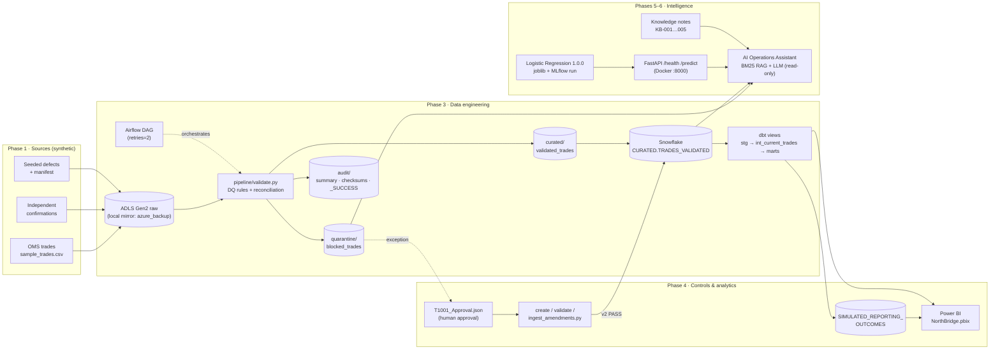

# NorthBridge TradeFlow — Implemented Architecture

This page describes the system **as built** at the end of Phase 7, and states where it differs from the target design in `docs/Design.md` §12 and §15.6.

## 1. End-to-end flow

The T-1001 golden thread follows this path: captured at GBP 100M → blocked by `DEMO_NOTIONAL_MISMATCH` and quarantined → human approval `NB-T1001-APP-001` → v2 at GBP 10M → revalidated PASS → loaded as current version → simulated submission `SIM-T-1001-V2` ACCEPTED → dashboard → risk score 0.0788 (Not Flagged) → assistant explanation with citations.

## 2. Components

| Layer | Component | Location | Technology |
| --- | --- | --- | --- |
| Source | Synthetic trades, confirmations, seeded defects | `data/Phase_1`, `scripts/Phase_1` | Python, CSV |
| Landing | Raw zone | ADLS Gen2 `northbridge-tradeflow/raw` | Azure Data Lake |
| Validation | DQ-001…009, confirmation reconciliation, quarantine, checksums, idempotent batch | `Phase_3…/pipeline/validate.py` | Python, pandas |
| Orchestration | Validation DAG, local runner | `Phase_3…/airflow`, `orchestration/run_pipeline.py` | Airflow 3.1 (Docker) |
| Warehouse | Curated tables | Snowflake `NORTHBRIDGE_TRADEFLOW.CURATED` | Snowflake |
| Transformation | Staging, current-trade and version-history views, marts | `Phase_3…/northbridge_dbt` | dbt Core |
| Controls | Approval, amendment, revalidation, controlled ingestion | `Phase_4…/amendments` | Python, Snowflake |
| Reporting | Simulated reporting outcomes | `Phase_4…/Simulated Reporting_Outcome_SQL.txt` | Snowflake SQL |
| Analytics | KPI SQL, dashboard | `Phase_4…/KPI_SQL.txt`, `NorthBridge.pbix` | SQL, Power BI |
| ML | Rejection-risk model, model card | `Phase_5…/notebook` | scikit-learn, SHAP, MLflow |
| Serving | Prediction API | `Phase_6…/app`, `Dockerfile` | FastAPI, Docker |
| AI | Ops assistant, retriever, knowledge notes, UI | `Phase_6…/assistant`, `knowledge`, `chat_ui.py` | BM25, GPT-4.1 mini (Euri), Streamlit |
| Assurance | Golden thread, integration/UAT suite, RTM, CI | `Phase_7…`, `.github/workflows/ci.yml` | pytest, SQLite, GitHub Actions |

## 3. Target vs implemented

| Area | Target design | As built | Why / impact |
| --- | --- | --- | --- |
| Processing | Python / **PySpark** | pandas only | 50 trades do not need Spark. No impact at this scale. |
| Raw storage | ADLS Gen2 | ADLS Gen2 **and** a local mirror (`STORAGE_MODE=local`) | Local mirror enables offline runs and CI. |
| Warehouse in CI | Snowflake | **SQLite mirror** of the dbt views, reporting INSERT and KPI SQL (`nbit/warehouse.py`) | Snowflake needs credentials and costs money. The mirror ports the same SQL; syntax-only differences are listed in the module. |
| Capture API | `POST /api/v1/trades` with idempotency keys (Design §13.3) | **File-based batch capture**; idempotency by content-derived batch ID | No REST capture service was built. Replay safety is proven at batch level (TC-CAP-003). |
| Prediction API | `POST /api/v1/predictions/rejection-risk` taking `trade_id` + `trade_version` (§13.7) | `POST /predict` taking feature values | Caller must supply features; the API cannot look up a trade version itself. |
| Approval | Role-based approval service (§14) | **Approval JSON** verified by `ingest_amendments.verify_batch` | Approval evidence is enforced; **who** may approve is not (NFR-003 open). |
| Audit | Unified lifecycle event store (NFR-004) | Evidence per component; trail **reconstructed** by `nbit/audit_trail.py` | Complete for T-1001, but no single store to query. |
| Reporting | Rule-based simulated validation of report fields | **Positional** outcome: every 10th current trade by ID is rejected | Proves plumbing and replay safety, not reporting logic. |
| Orchestration in CI | Airflow | Direct Python calls | Airflow retries are not exercised by CI. |

## 4. Reproducibility

- Raw inputs are committed under `Phase_7…/fixtures/raw`, byte-identical to the recorded Phase 3 batch (SHA-256 in `fixture_manifest.json`; `.gitattributes` stops Git rewriting line endings).
- The batch ID is a hash of input checksums + policy version, so a clean checkout regenerates **`BATCH-60FD5666D0A1FBAD`** exactly (TC-VAL-004).
- The model is pinned by SHA-256 in `ops/model_registry.json`; the API refuses to start on any other artifact when `NB_EXPECTED_MODEL_SHA256` is set.
- Dependencies are pinned (`requirements-ci.txt`, `Phase_6…/requirements-api.txt`) to the project environment (Python 3.12).
- CI needs no secrets: nothing in the automated path calls Azure, Snowflake or the LLM.
