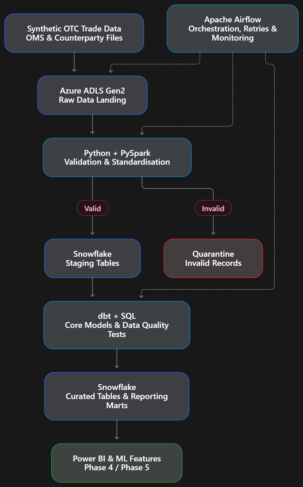

# NorthBridge-TradeFlow

An end-to-end OTC Trade Lifecycle Intelligence platform integrating Business Analysis, Data Engineering, Snowflake, Machine Learning, and Agentic AI to automate trade validation, detect exceptions, predict reporting risks, and deliver actionable operational insights.

## Phase 1 — Business & Domain Foundation

### Objective

Establish the business foundation for **NorthBridge TradeFlow**, an end-to-end OTC trade lifecycle solution designed to reduce manual processing errors, improve trade validation, and strengthen operational traceability.

### Business Problem

Manual trade capture and re-keying can introduce incorrect trade details, leading to reconciliation breaks, delayed corrections, and reporting exceptions.

### Scope & Key Activities

- **Business Analysis:** Define stakeholder responsibilities, business requirements (BRD), and product requirements (PRD).
- **Process Mapping:** Document the AS-IS OTC trade lifecycle and identify operational inefficiencies.
- **Data Definition:** Establish a standardised trade data dictionary and synthetic trade dataset.
- **Data Quality:** Define seeded validation defects and expected control outcomes.
- **KPI Framework:** Specify Straight-Through Processing (STP), defect rates, reporting outcomes, and processing latency.
- **Trade Scenario:** Establish T-1001, a 10-year GBP interest rate swap with an incorrect notional amount, as the core demonstration case.

### Tools & Technologies

`Markdown` · `Excel` · `draw.io` · `Git`

### Key Deliverables

- `Foundation.md` — Project charter, BRD, PRD, stakeholder analysis, and domain glossary.
- `AS_IS.drawio` — Current-state business process.
- `Data_Dictionary.xlsx` — Trade data definitions.
- `sample_trades.csv` — 50 synthetic OTC trades.
- `seeded_errors.csv` — Intentional data-quality defects.
- `T1001_Trade_Card.md` — Trade exception and amendment scenario.

### Expected Outcome

A documented business foundation with defined requirements, standardised trade data, measurable KPIs, and a traceable trade scenario to support solution design and implementation in Phase 2.

## Phase 2 — Requirements, Solution & System Design

### Objective

Translate business requirements into a structured, scalable technical solution for **NorthBridge TradeFlow**, defining system architecture, data flows, functional requirements, and implementation boundaries.

### Scope & Key Activities

- **Business Process Design:** Define the TO-BE trade lifecycle using BPMN, including trade capture, amendment, cancellation, and human approval.
- **Requirements Engineering:** Specify functional requirements (FRs), non-functional requirements (NFRs), user stories, and acceptance criteria.
- **Solution Architecture:** Design the high-level architecture (HLD), system integrations, and trust boundaries.
- **Data Modelling:** Define trade, counterparty, product, validation, event, and reporting entities.
- **API & Security Design:** Establish API contracts, error handling, access roles, and audit requirements.
- **Agile Planning:** Prioritise requirements using MoSCoW, estimate user stories, maintain a RAID log, and establish a Requirements Traceability Matrix (RTM).

### Tools & Technologies

`draw.io` · `Markdown` · `Excel` · `Git` · `Agile` · `SDLC`

### Key Deliverables

- `Design.md` — Functional and non-functional requirements, API contracts, and security design.
- `TO_BE.drawio` — Future-state trade lifecycle process.
- `HLD.drawio` — High-level solution architecture and system integrations.
- `Delivery_Tracker.xlsx` — Product backlog, MoSCoW prioritisation, story estimates, RAID log, and RTM.

### Expected Outcome

A clearly defined and traceable solution blueprint with agreed data contracts, system architecture, security requirements, and prioritised implementation scope, providing the foundation for **Phase 3 — Data Engineering & Governance**.

## Phase 3 — Data Engineering & Governance

### Objective

Build a reliable, scalable, and governed data foundation for **NorthBridge TradeFlow**, enabling automated trade ingestion, validation, transformation, and analytics-ready data delivery.

### Scope & Key Activities

- **Data Ingestion:** Land synthetic OTC trade data in Azure Data Lake Storage Gen2 with timestamps, run IDs, and checksums.
- **ETL Pipeline:** Develop Python and PySpark workflows for data cleansing, standardisation, and validation.
- **Data Warehousing:** Build Snowflake staging, core, and reporting tables using SQL and dbt.
- **Workflow Orchestration:** Automate ingestion, validation, transformation, and testing using Apache Airflow with retry and failure handling.
- **Data Quality:** Implement schema validation, duplicate detection, reconciliation, and quarantine of invalid records.
- **Data Governance:** Define data ownership, classification, lineage, and access controls.
- **Trade Versioning:** Preserve original and amended T-1001 trade records with complete audit traceability.

### Data Pipeline Architecture

The pipeline follows an end-to-end data engineering workflow:

**Source → Ingestion → Validation → Warehousing → Transformation → Analytics**

Synthetic OTC trade data is ingested into **Azure ADLS Gen2**, validated and standardised using **Python/PySpark**, and loaded into **Snowflake**. **dbt** transforms the data into trusted reporting marts, while **Apache Airflow** orchestrates pipeline execution, retries, and monitoring. Invalid records are quarantined, and trade version history is preserved for auditability.

The curated datasets support **Power BI analytics (Phase 4)** and **predictive risk modelling (Phase 5)**.

### Tools & Technologies

`Azure ADLS Gen2` · `Python` · `PySpark` · `Apache Airflow` · `Snowflake` · `SQL` · `dbt` · `Microsoft Purview (Optional)`

### Key Deliverables

- `pipeline/` — Automated ingestion and transformation workflows.
- `dbt/` — SQL transformation models and data quality tests.
- `Data_Model.md` — Warehouse schema and entity relationships.
- `Data_Quality_Plan.md` — Validation rules and reconciliation strategy.
- `Governance.md` — Data ownership, classification, and lineage.
- **Execution Evidence** — Pipeline logs, test results, and curated datasets.

### Expected Outcome

A reproducible, quality-controlled data pipeline that transforms raw OTC trade records into trusted, analytics-ready datasets while maintaining trade history, auditability, and data governance.

**Next:** Phase 4 — Analytics & Regulatory Intelligence.
