# NorthBridge-TradeFlow

An end-to-end OTC Trade Lifecycle Intelligence platform integrating Business Analysis, Data Engineering, Snowflake, Machine Learning, and Agentic AI to automate trade validation, detect exceptions, predict reporting risks, and deliver actionable operational insights.


## Phase 1 — Business & Domain Foundation

### Objective

Establish the business foundation for **NorthBridge TradeFlow**, an end-to-end OTC trade lifecycle solution designed to reduce manual processing errors, improve trade validation, and strengthen operational traceability.

### Business Problem

Manual trade capture and re-keying can introduce incorrect trade details, leading to reconciliation breaks, delayed corrections, and reporting exceptions.

### Scope & Key Activities

- **Business Analysis:** Define stakeholder responsibilities, business requirements (BRD), and product requirements (PRD).
- **Process Mapping:** Document the AS-IS OTC trade lifecycle and identify operational inefficiencies.
- **Data Definition:** Establish a standardised trade data dictionary and synthetic trade dataset.
- **Data Quality:** Define seeded validation defects and expected control outcomes.
- **KPI Framework:** Specify Straight-Through Processing (STP), defect rates, reporting outcomes, and processing latency.
- **Trade Scenario:** Establish T-1001, a 10-year GBP interest rate swap with an incorrect notional amount, as the core demonstration case.

### Tools & Technologies

`Markdown` · `Excel` · `draw.io` · `Git`

### Key Deliverables

- `Foundation.md` — Project charter, BRD, PRD, stakeholder analysis, and domain glossary.
- `AS_IS.drawio` — Current-state business process.
- `Data_Dictionary.xlsx` — Trade data definitions.
- `sample_trades.csv` — 50 synthetic OTC trades.
- `seeded_errors.csv` — Intentional data-quality defects.
- `T1001_Trade_Card.md` — Trade exception and amendment scenario.

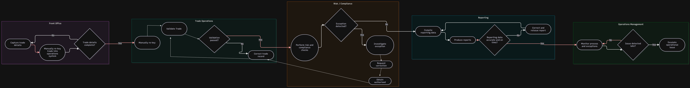

### Expected Outcome

A documented business foundation with defined requirements, standardised trade data, measurable KPIs, and a traceable trade scenario to support solution design and implementation in Phase

## Phase 2 — Requirements, Solution & System Design

### Objective

Translate business requirements into a structured, scalable technical solution for **NorthBridge TradeFlow**, defining system architecture, data flows, functional requirements, and implementation boundaries.

### Scope & Key Activities

- **Business Process Design:** Define the TO-BE trade lifecycle using BPMN, including trade capture, amendment, cancellation, and human approval.
- **Requirements Engineering:** Specify functional requirements (FRs), non-functional requirements (NFRs), user stories, and acceptance criteria.
- **Solution Architecture:** Design the high-level architecture (HLD), system integrations, and trust boundaries.
- **Data Modelling:** Define trade, counterparty, product, validation, event, and reporting entities.
- **API & Security Design:** Establish API contracts, error handling, access roles, and audit requirements.
- **Agile Planning:** Prioritise requirements using MoSCoW, estimate user stories, maintain a RAID log, and establish a Requirements Traceability Matrix (RTM).

### Tools & Technologies

`draw.io` · `Markdown` · `Excel` · `Git` · `Agile` · `SDLC`

### Key Deliverables

- `Design.md` — Functional and non-functional requirements, API contracts, and security design.
- `TO_BE.drawio` — Future-state trade lifecycle process.
- `HLD.drawio` — High-level solution architecture and system integrations.
- `Delivery_Tracker.xlsx` — Product backlog, MoSCoW prioritisation, story estimates, RAID log, and RTM.

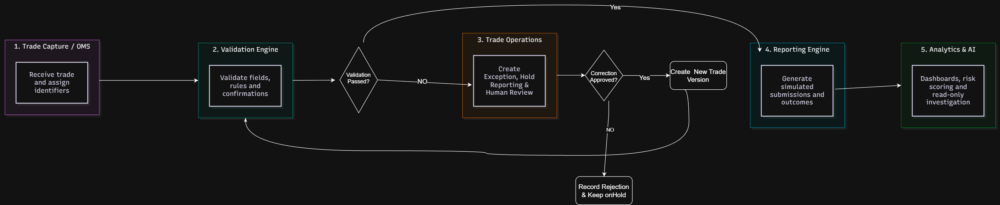

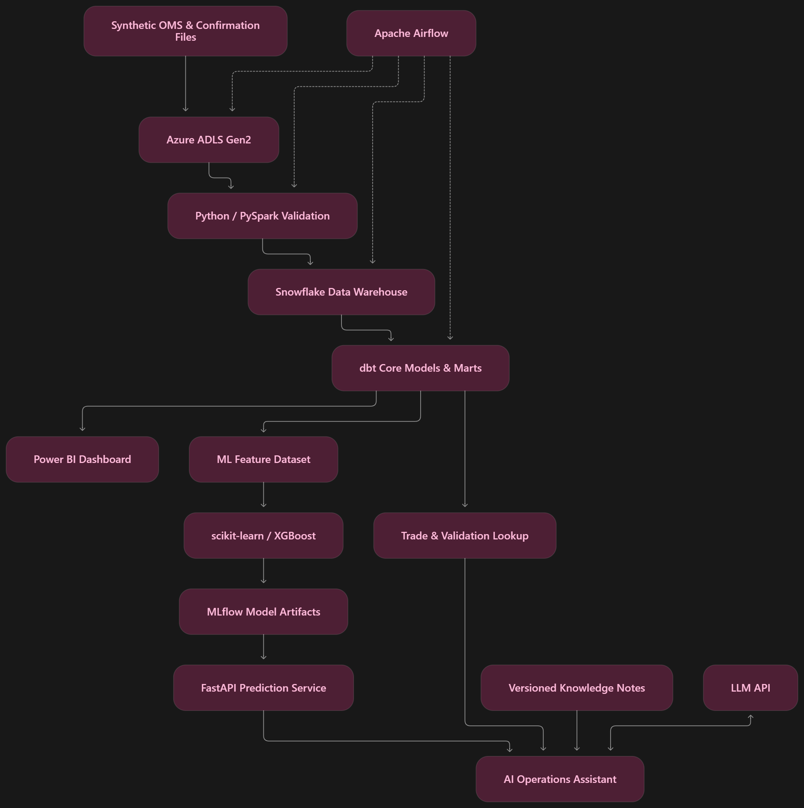

### Expected Outcome

A clearly defined and traceable solution blueprint with agreed data contracts, system architecture, security requirements, and prioritised implementation scope, providing the foundation for **Phase 3 — Data Engineering & Governance**.

## Phase 3 — Data Engineering & Governance

### Objective

Build a reliable, scalable, and governed data foundation for **NorthBridge TradeFlow**, enabling automated trade ingestion, validation, transformation, and analytics-ready data delivery.

### Scope & Key Activities

- **Data Ingestion:** Land synthetic OTC trade data in Azure Data Lake Storage Gen2 with timestamps, run IDs, and checksums.
- **ETL Pipeline:** Develop Python and PySpark workflows for data cleansing, standardisation, and validation.
- **Data Warehousing:** Build Snowflake staging, core, and reporting tables using SQL and dbt.
- **Workflow Orchestration:** Automate ingestion, validation, transformation, and testing using Apache Airflow with retry and failure handling.
- **Data Quality:** Implement schema validation, duplicate detection, reconciliation, and quarantine of invalid records.
- **Data Governance:** Define data ownership, classification, lineage, and access controls.
- **Trade Versioning:** Preserve original and amended T-1001 trade records with complete audit traceability.

### Data Pipeline Architecture

The pipeline follows an end-to-end data engineering workflow:

**Source → Ingestion → Validation → Warehousing → Transformation → Analytics**

Synthetic OTC trade data is ingested into **Azure ADLS Gen2**, validated and standardised using **Python/PySpark**, and loaded into **Snowflake**. **dbt** transforms the data into trusted reporting marts, while **Apache Airflow** orchestrates pipeline execution, retries, and monitoring. Invalid records are quarantined, and trade version history is preserved for auditability.

The curated datasets support **Power BI analytics (Phase 4)** and **predictive risk modelling (Phase 5)**.

### Tools & Technologies

`Azure ADLS Gen2` · `Python` · `PySpark` · `Apache Airflow` · `Snowflake` · `SQL` · `dbt` · `Microsoft Purview (Optional)`

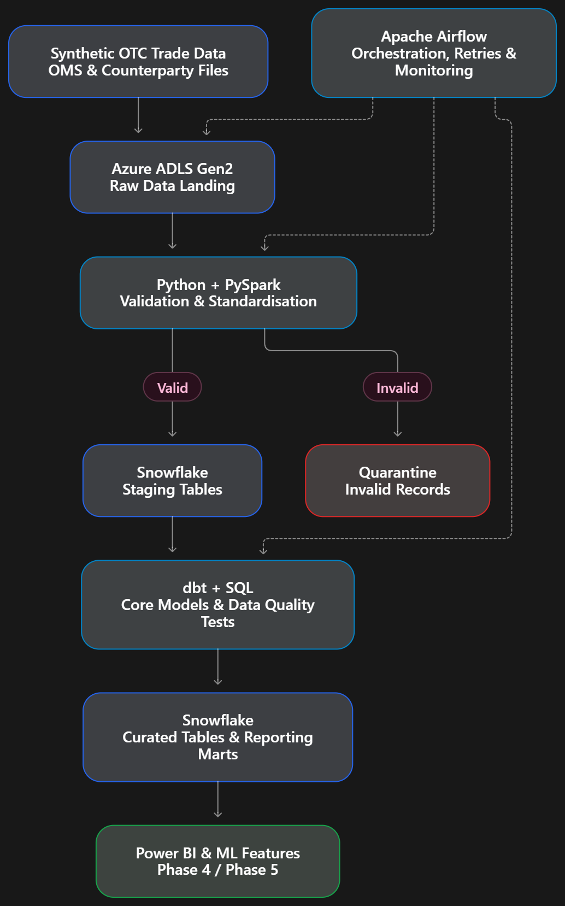

### Key Deliverables

- `pipeline/` — Automated ingestion and transformation workflows.
- `dbt/` — SQL transformation models and data quality tests.
- `Data_Model.md` — Warehouse schema and entity relationships.
- `Data_Quality_Plan.md` — Validation rules and reconciliation strategy.
- `Governance.md` — Data ownership, classification, and lineage.
- **Execution Evidence** — Pipeline logs, test results, and curated datasets.

### Expected Outcome

A reproducible, quality-controlled data pipeline that transforms raw OTC trade records into trusted, analytics-ready datasets while maintaining trade history, auditability, and data governance.

## Phase 4 — Analytics & Regulatory Intelligence

### Objective

Transform validated OTC trade data into actionable business insights through **Power BI reporting, KPI monitoring, regulatory field mapping, and exception analysis**.

### Scope & Key Activities

- **Power BI Dashboard:** Visualise trade volumes, Straight-Through Processing (STP), validation failure rates, simulated reporting rejections, and processing latency.
- **KPI Development:** Build and reconcile operational KPIs using SQL and Power BI.
- **Regulatory Field Mapping:** Map trade attributes to simulated reporting fields, documenting transformations and validation rules.
- **Exception Management:** Analyse validation failures, reconciliation breaks, and simulated reporting rejections.
- **Trade Monitoring:** Track T-1001's notional mismatch, amendment history, and resolution status.
- **Business Insights:** Identify key failure drivers and recommend improvements to trade processing and data quality.

### Tools & Technologies

`Power BI` · `SQL` · `Python (Pandas)` · `Excel`

### Key Deliverables

- `NorthBridge.pbix` — Interactive trade monitoring dashboard.
- `KPI_SQL.sql` — SQL-based KPI calculations and reconciliation.
- `Regulatory_Field_Mapping.xlsx` — Trade-to-report field mapping.
- `Validation_Rules.md` — Trade validation rules.
- `Reject_Handling.md` — Exception handling and resubmission workflow.
- `Business_Insights.md` — Key findings and recommendations.

### Expected Outcome

An analytics and reporting layer that provides visibility into trade processing performance, data-quality issues, and simulated reporting outcomes, supporting faster exception investigation and operational decision-making.

### Trade Operations Dashboard

The reporting page provides a consolidated view of trade lifecycle performance, validation outcomes, and operational exceptions.

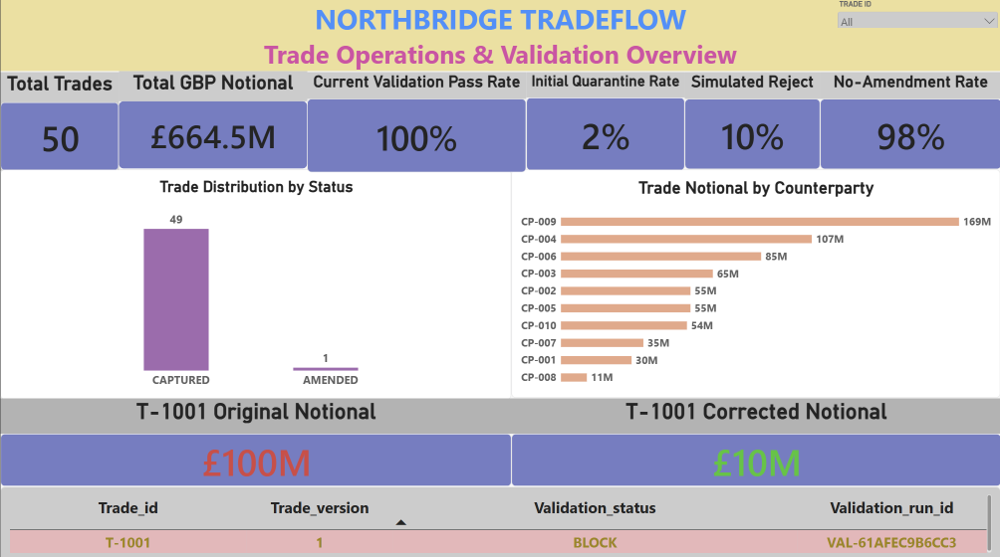

## Phase 5 — Data Science & Predictive Intelligence

### Objective

Develop and evaluate a machine learning solution to **predict simulated OTC trade reporting rejection risk**, identify high-risk transactions before submission, and assess model behaviour against real CME market data.

### Scope & Key Activities

- **Data Preparation:** Generate a reproducible synthetic dataset (~2,000 trades) for model development, separate from the UAT dataset.
- **Feature Engineering:** Create pre-submission trade features, prevent data leakage, and apply time-based train, validation, and test splits.
- **Model Development:** Train and compare Dummy Classifier, Logistic Regression, XG-Boost, Random Forest, Cat-Boost models.
- **Model Evaluation:** Evaluate predictive performance using Precision, Recall, F1-score, PR-AUC, and Confusion Matrix.
- **Model Explainability:** Use SHAP to identify important features influencing rejection-risk predictions.
- **T-1001 Risk Prediction:** Generate a model-based rejection probability and risk classification for the project's core trade scenario.
- **Real CME Data Validation:** Process real GBP OIS transaction records from CME, apply the trained model, and assess prediction behaviour and distribution shift.

### Tools & Technologies

`Python` · `Pandas` · `Scikit-learn` · `XGBoost` · `SHAP` · `Matplotlib` · `CME Market Data`

### Key Deliverables

- Reproducible ML training and evaluation notebook.
- Feature engineering and preprocessing pipeline.
- Trained model and performance evaluation.
- `Model_Card.md` — Model metrics, threshold selection, leakage checks, and limitations.
- SHAP feature importance analysis.
- T-1001 trade rejection-risk prediction.
- External CME data processing and model inference results.

### Model Evaluation & Results

**1. Model Performance Comparison**

Comparison of baseline and candidate models using classification metrics, including PR-AUC.

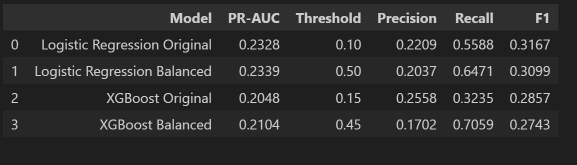

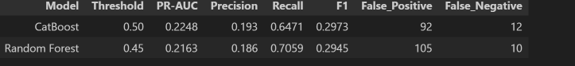

**2. Confusion Matrix**

Evaluation of the selected model's predictions against held-out synthetic reporting outcomes.

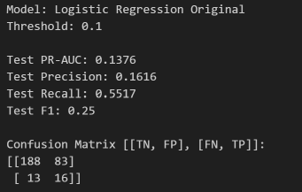

**3. SHAP Feature Importance**

Identification of key features influencing the model's rejection-risk predictions.

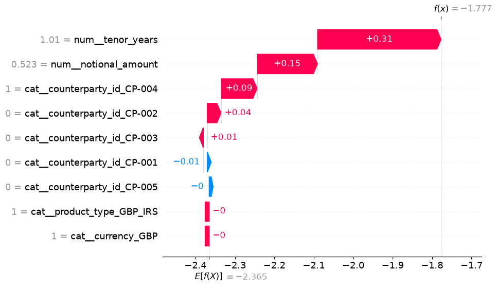

**4. T-1001 — Trade Rejection Risk Prediction**

Model-generated rejection probability and risk classification for the core trade scenario.

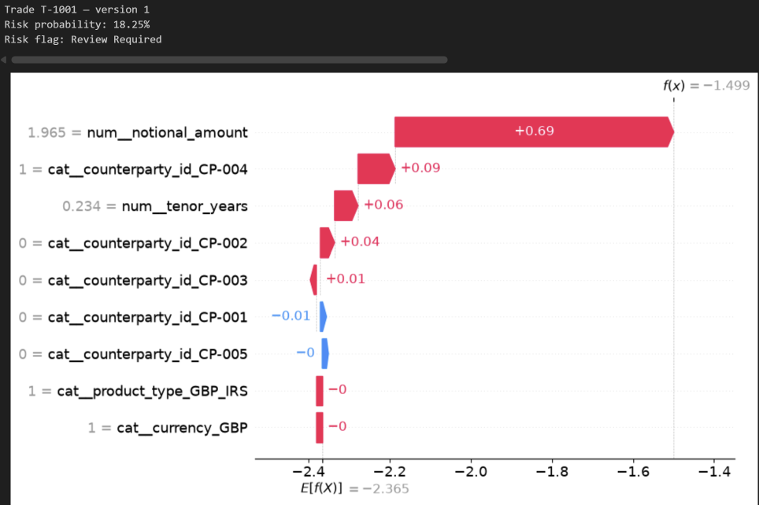

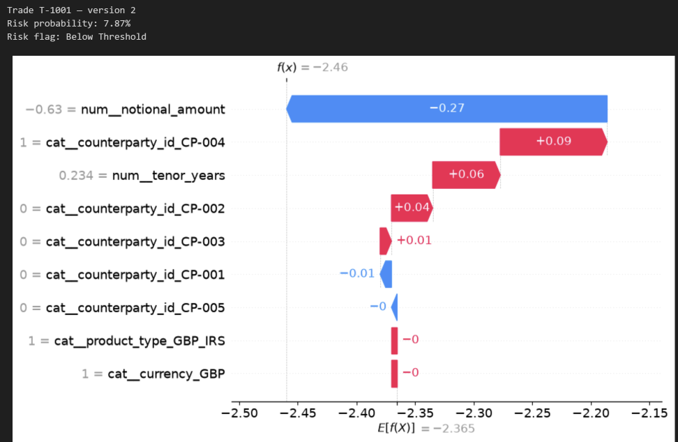

### Real-World Data Check — CME Market Data

To assess model behaviour beyond synthetic training data, real **CME GBP Overnight Index Swap (OIS)** transaction records were processed and evaluated.

**Data Processing:**

- Processed 44 CME source files.
- Identified 102 GBP records and excluded 56 inflation-indexed records.
- Retained 46 GBP OIS records, resulting in **28 unique transactions** after deduplication.

**External Inference Results:**

| Metric                               | Result |
| ------------------------------------ | ------ |
| Unique transactions evaluated        | 28     |
| Below risk threshold                 | 24     |
| Flagged for review                   | 4      |
| Outside synthetic training ranges    | 8      |
| Review alerts within training ranges | 0      |

**5. CME Data Preparation**

Evidence of real market data filtering, cleaning, and deduplication.

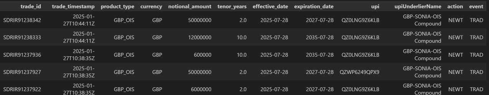

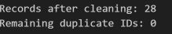

**6. CME Model Prediction Results**

Evidence of model inference on real CME transactions, including risk classifications and out-of-range feature checks.

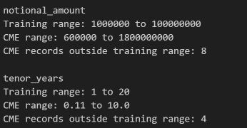

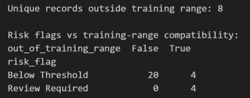

### Key Findings & Limitations

- The modelling workflow provides a reproducible approach to estimating simulated trade reporting rejection risk.
- Real CME data testing demonstrated external inference compatibility, with **4 of 28 transactions flagged for review**.
- All four review alerts occurred on transactions with features outside synthetic training ranges, indicating potential distribution shift.

### Expected Outcome

An explainable and reproducible predictive intelligence solution combining **synthetic-data model evaluation, trade-level risk scoring, and real-market-data inference testing**, providing the foundation for  ML Engineering & AI Operations Assistant.

## Phase 6 — ML Engineering & AI Operations Assistant

### Objective

Deploy the trained trade rejection-risk model as a containerised prediction API and integrate it with an **LLM-powered AI Operations Assistant** for trade investigation, validation analysis, risk assessment, and evidence-based recommendations.

### Scope & Key Activities

- **ML Model Deployment:** Serve the trained model through FastAPI with versioned predictions.
- **API Development:** Implement `/health` and `/predict` endpoints with structured JSON requests and responses.
- **Containerisation:** Package the prediction service using Docker, exposing port `8000`.
- **AI Operations Assistant:** Build an interactive, read-only assistant integrating trade records, validation history, ML predictions, and retrieved knowledge notes.
- **RAG Integration:** Retrieve relevant domain knowledge and validation rules to generate evidence-backed answers with citations.
- **Operational Safety:** Separate deterministic validation decisions from predictive risk scores and require human intervention for trade amendments.

### Tools & Technologies

`Python` `MLflow`·`FastAPI` · `Docker` · `Scikit-learn` · `LLM API (GPT-4.1 mini)` · `RAG` · `Streamlit`

### Key Deliverables

- Containerised ML prediction API.
- REST endpoints for health monitoring and risk prediction.
- Interactive API documentation using Swagger UI.
- AI Operations Assistant with trade lookup, validation history, ML scoring, and cited responses.
- Versioned knowledge notes and read-only investigation workflow.

### System Workflow

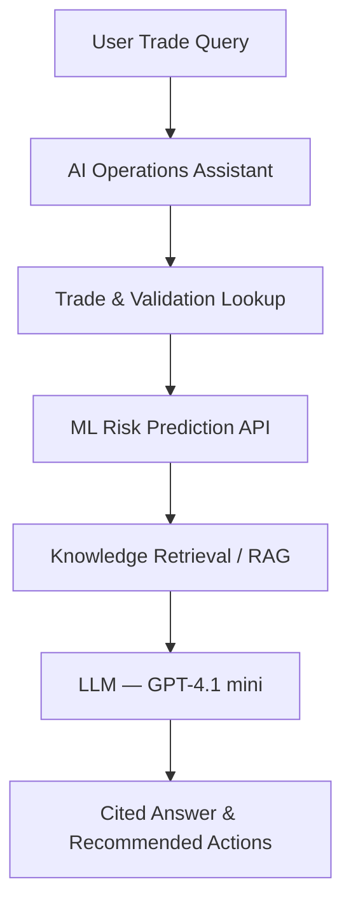

### Implementation Results & Evidence

**1. Docker — Containerised Prediction API**

The prediction service was packaged in a Docker image named `northbridge-prediction-api`, with port mapping `8000:8000`.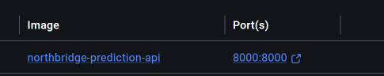

**2. FastAPI — Prediction Service**

The API exposes two endpoints:

| Endpoint     | Method | Purpose                                   |
| ------------ | ------ | ----------------------------------------- |
| `/health`  | GET    | Check API availability                    |
| `/predict` | POST   | Generate trade rejection-risk predictions |

Swagger UI provides an interactive interface for testing requests and inspecting responses.

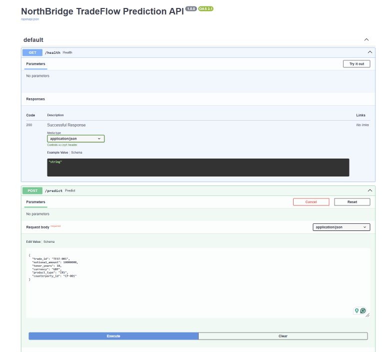

### Sample API Test Cases

**Test 1 — API Health Check**

```bash
curl http://localhost:8000/health
```

Expected: HTTP `200 OK` with a successful health response.

**Test 2 — Predict Trade T-1001 (Original Version)**

```bash
curl -X POST "http://localhost:8000/predict" \
  -H "Content-Type: application/json" \
  -d '{
    "trade_id": "TEST-001",
    "notional_amount": 100000000,
    "tenor_years": 10,
    "currency": "GBP",
    "product_type": "IRS",
    "counterparty_id": "CP-001"
  }'
```

Expected: HTTP `200 OK` with the model-generated risk score, classification, and model version.

**Test 3 — Predict T-1001 (Corrected Notional)**

Repeat Test 2 with:

```json
{
  "trade_id": "TEST-002",
  "notional_amount": 10000000,
  "tenor_years": 10,
  "currency": "GBP",
  "product_type": "IRS",
  "counterparty_id": "CP-001"
}
```

Expected: A valid prediction for the corrected trade. A lower risk score is not guaranteed.

**Test 4 — Invalid Input Validation**

Submit a request with a missing required field or invalid data type.

Expected: HTTP `422 Unprocessable Entity` with validation details, assuming FastAPI/Pydantic request validation.

### AI Operations Assistant — Final Implementation

The AI Operations Assistant provides a conversational interface for investigating trade exceptions, reviewing validation evidence, and interpreting ML predictions.

**Demonstrated T-1001 Results:**

- **Original trade (v1):** GBP 100,000,000 notional; blocked by `DEMO_NOTIONAL_MISMATCH`.
- **Corrected trade (v2):** GBP 10,000,000 notional; passed validation and became eligible for simulated reporting.
- **ML Risk Score (v2):** `0.078752`, classified as **Not Flagged** against a `0.10` threshold using model version `1.0.0`.
- **Evidence-Based Response:** The assistant retrieved validation history, cited knowledge notes, and explained why the corrected trade was eligible.
- **Human Oversight:** The assistant provided recommendations without directly modifying trade records.

**3. AI Operations Assistant — Final Interface**

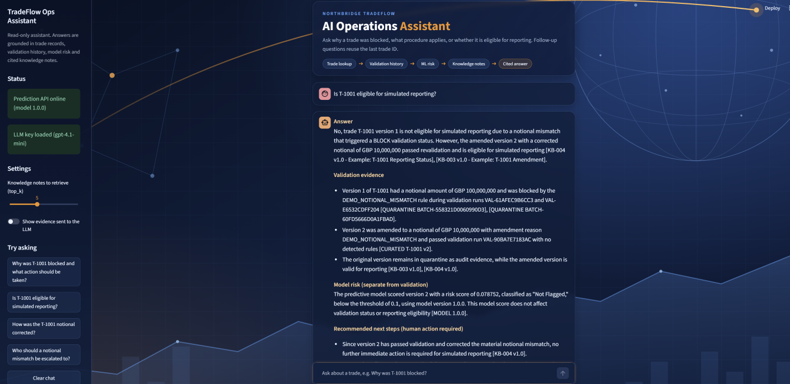

### Expected Outcome

A containerised ML inference service integrated with a read-only, RAG-powered AI Operations Assistant, enabling explainable trade-risk predictions, evidence-based exception investigation, and human-controlled operational decisions.

### Limitations

The system uses synthetic trade and validation records with a model trained on simulated outcomes. Predictions support risk assessment but do not determine regulatory reporting eligibility or establish real-world rejection accuracy.

## Phase 7 — Integration Testing, Deployment & Portfolio

### Objective

Prove that the components from Phases 1–6 form **one reproducible system**, close the requirements traceability chain, and prepare an honest demonstration of what was built.

### Scope & Key Activities

- **Golden Thread:** One command replays T-1001 through original capture → exception → approved amendment → revalidation → simulated reporting → dashboard → prediction → assistant explanation, using the real code from each phase.
- **Integration & UAT Testing:** 49 automated tests mapped to 43 test cases, covering every Must requirement, plus replay, fault injection and model rollback.
- **Traceability:** The Requirements Traceability Matrix and `Delivery_Tracker.xlsx` are generated from saved test results, not edited by hand.
- **CI:** A GitHub Actions workflow runs unit, integration and container checks from a clean checkout, without any cloud credentials.
- **Operations:** Runbook for startup, configuration, teardown, monitoring signals and rollback to a checksum-pinned model version.

### Tools & Technologies

`pytest` · `GitHub Actions` · `Docker Compose` · `SQLite` · `FastAPI TestClient` · `openpyxl`

### Key Deliverables

- `nbit/golden_thread.py` — End-to-end T-1001 run with evidence report.
- `tests/` — Integration, UAT, NFR and operations test suite.
- `evidence/RTM.md` — Requirements → tests → results → stated gaps.
- `.github/workflows/ci.yml` — Core automated checks.
- `ops/RUNBOOK.md`, `ops/model_registry.json` — Operations and rollback.
- `docs/ARCHITECTURE.md`, `docs/PORTFOLIO_MAP.md`, `docs/EVIDENCE_INDEX.md`, `docs/INTEGRATION_FINDINGS.md`.

### Results

| Golden thread stage | T-1001 outcome                                                                                                 |
| ------------------- | -------------------------------------------------------------------------------------------------------------- |
| Capture             | v1 at GBP 100,000,000 retained unchanged                                                                       |
| Validation          | `DEMO_NOTIONAL_MISMATCH` → BLOCK; batch `BATCH-60FD5666D0A1FBAD` reproduced exactly from committed inputs |
| Amendment           | Approval `NB-T1001-APP-001` → v2 at GBP 10,000,000; v1 untouched                                            |
| Revalidation        | v2 PASS; approval and source checksum verified                                                                 |
| Simulated reporting | `SIM-T-1001-V2` ACCEPTED; replay creates 0 duplicates                                                        |
| Dashboard           | All Power BI KPIs (50 · £664.5M · 100% · 2% · 10% · 98%) reconcile with SQL                              |
| Prediction          | v1 0.1825 *Flagged* · v2 0.0788 *Not Flagged* (model 1.0.0)                                               |
| Assistant           | Cited, read-only explanation; no stored file changed                                                           |

- **43 test cases: 40 passed, 0 failed, 3 not run** (cancellation not built; Power BI walkthrough and live-LLM review are manual).
- **15 Must requirements:** 4 Verified, 9 implemented with stated gaps, 2 In Progress (no role-based authorisation).

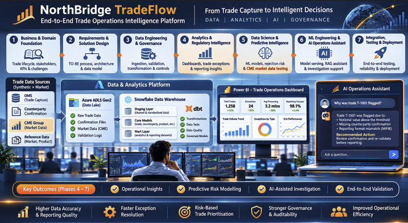

### Limitations

Simulated reporting outcomes are positional (every 10th trade is rejected), not rule-based. CI uses a SQLite port of the Snowflake/dbt SQL and an offline template LLM. Role-based access control, trade cancellation and a unified audit event store were not built. See `Phase_7_Integration Testing and Deployment/docs/INTEGRATION_FINDINGS.md`.
