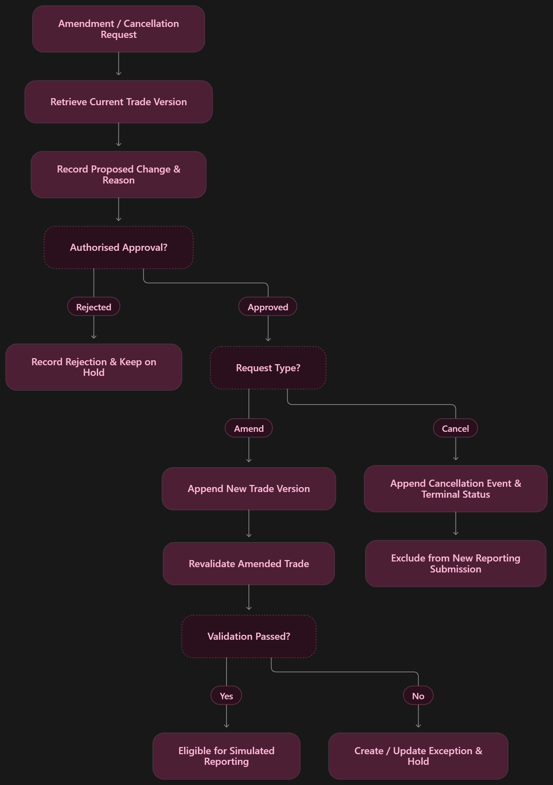
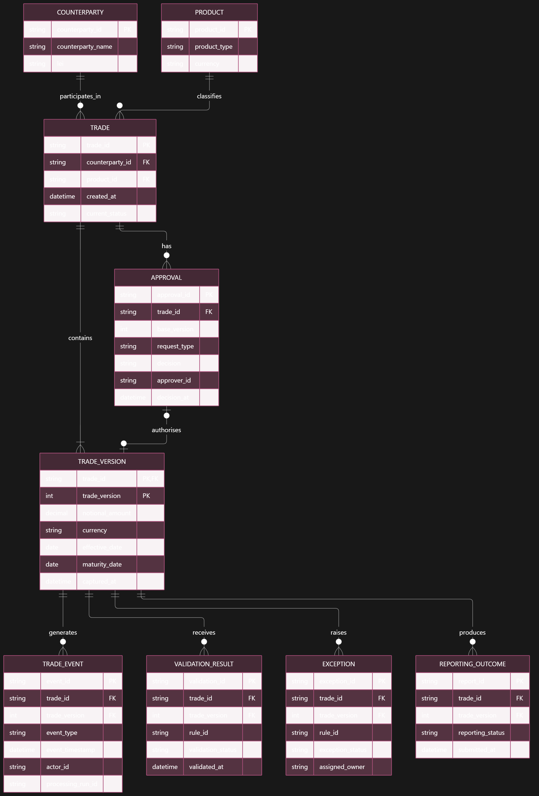
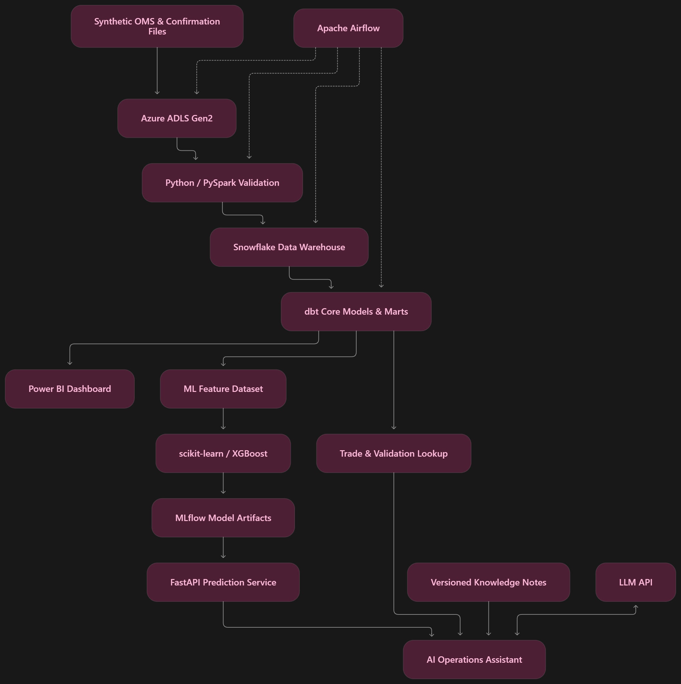

## 5. TO-BE Business Process

### Objective

Establish an automated and auditable OTC trade lifecycle
that detects trade-data errors before simulated reporting.

### Future-State Process

1. Capture trade from the synthetic OMS source.
2. Assign stable trade and version identifiers.
3. Validate schema, mandatory fields and business rules.
4. Compare relevant trade terms with independent confirmation.
5. Route failed trades to an exception queue.
6. Assign an authorised reviewer.
7. Require approval before material correction.
8. Append a new trade version without overwriting history.
9. Revalidate the corrected version.
10. Create a simulated reporting submission and outcome.
11. Publish validated operational data for analytics.
12. Support risk prediction and read-only AI investigation.

### Business Rules

`RULE-TOBE-001`: Every trade must have a stable trade identifier.

`RULE-TOBE-002`: Every amendment creates a new trade version.

`RULE-TOBE-003`: Failed validation blocks simulated reporting.

`RULE-TOBE-004`: Material corrections require human approval.

`RULE-TOBE-005`: Original trade versions and audit events are retained.

`RULE-TOBE-006`: Revalidation is mandatory after amendment.

`RULE-TOBE-007`: Reprocessing must not duplicate records or events.

`RULE-TOBE-008`: Simulated reporting outcomes must be distinguishable
from internal validation results.

### Exception Handling

If validation fails:

- Record the failed rule ID.
- Create an exception record.
- Hold the trade from reporting.
- Assign an exception owner.
- Record the review decision.
- Revalidate any approved amendment.

If a correction is rejected:

- Preserve the original trade and exception.
- Record the rejection reason.
- Keep reporting blocked pending authorised resolution.

### Golden Thread

T-1001 v1: GBP 100,000,000
Expected: GBP 10,000,000
Rule: DEMO_NOTIONAL_MISMATCH
Action: Human-approved amendment
T-1001 v2: GBP 10,000,000
Outcome: Revalidation and simulated reporting

## 6. Use Case UC-001 — Capture OTC Trade

### 6.1 Use Case Information

| Attribute        | Description                                          |
| ---------------- | ---------------------------------------------------- |
| Use Case ID      | UC-001                                               |
| Use Case Name    | Capture OTC Trade                                    |
| Primary Actor    | Trade Capture / OMS                                  |
| Supporting Actor | Validation Engine                                    |
| Priority         | Must Have                                            |
| Trigger          | New trade submitted from synthetic OMS               |
| Input            | Trade record conforming to the Phase 1 data contract |
| Output           | Persisted trade and capture audit event              |

### 6.2 Objective

Enable NorthBridge TradeFlow to capture a new OTC interest rate swap while maintaining stable trade identifiers, version history and an auditable record of the original submission.

The capture process must preserve the original trade data and forward the trade to the validation engine without silently modifying submitted values.

### 6.3 Preconditions

1. The synthetic OMS source is available.
2. The Phase 1 trade data contract has been defined.
3. The trade record contains the required capture fields.
4. The trade identifier has not previously been registered as a different trade.
5. The capture service has permission to create trade records.

### 6.4 Main Success Flow

1. OMS submits a new trade record.
2. The system receives the source trade identifier and capture timestamp.
3. The system validates mandatory fields, data types and structural formats.
4. The system checks whether the trade has already been captured.
5. The system assigns or confirms a stable trade identifier.
6. The system assigns `trade_version = 1` for a new trade.
7. The system stores the original submitted trade values.
8. The system creates a capture audit event.
9. The system records the capture processing status.
10. The system forwards the captured trade to the validation engine.

### 6.5 Alternative and Exception Flows

**AF-001 — Missing Mandatory Field**

- The system detects a missing required field.
- The record is rejected from normal processing or quarantined.
- The system records the field name, rule ID and failure reason.
- No validated trade is created.

**AF-002 — Duplicate Submission**

- The system detects that the same source submission has already been processed.
- The system returns the existing capture result.
- No duplicate trade version or audit event is created.

**AF-003 — Conflicting Trade Identifier**

- The system receives an existing trade ID with conflicting data but no valid amendment instruction.
- The system records an identifier conflict.
- The submitted record is held for investigation.
- The existing trade remains unchanged.

**AF-004 — Processing Failure**

- The system records the failed processing run.
- The source submission remains available for retry.
- Reprocessing uses the same idempotency key to avoid duplicate records.

### 6.6 Postconditions

**Successful Capture**

- Trade record is persisted.
- Stable trade identifier is retained.
- Initial trade version is recorded.
- Capture timestamp and source information are preserved.
- Audit event is created.
- Trade is eligible for subsequent business validation.

**Failed Capture**

- Existing trade records remain unchanged.
- Failure information is retained.
- Invalid input cannot proceed to simulated reporting.

### 6.7 Business Rules

- `RULE-CAP-001`: Every trade must have a stable identifier.
- `RULE-CAP-002`: A new trade begins with version 1.
- `RULE-CAP-003`: Original captured values must be preserved.
- `RULE-CAP-004`: Duplicate processing must not create duplicate records.
- `RULE-CAP-005`: Structural capture success does not imply business validation success.

### 6.8 Acceptance Criteria

**AC-001 — Successful Capture**

Given a structurally valid new trade submission
When the OMS submits the trade
Then the system must persist the trade with version 1 and create a capture audit event.

**AC-002 — Missing Required Data**

Given a trade missing a mandatory field
When capture validation executes
Then the system must reject or quarantine the submission and record an explicit error.

**AC-003 — Duplicate Submission**

Given a previously processed trade submission
When the identical submission is replayed
Then the system must not create another trade version or duplicate capture event.

**AC-004 — Original Data Preservation**

Given T-1001 with a captured notional of GBP 100,000,000
When the trade is captured
Then the system must retain the original notional without replacing it with the independently confirmed amount.

**AC-005 — Validation Handoff**

Given a successfully captured trade
When the capture stage completes
Then the trade must become available for business-rule and confirmation validation.

### 6.9 T-1001 Golden Thread

Trade ID: T-1001
Product: GBP Interest Rate Swap
Tenor: 10 Years
Captured Notional: GBP 100,000,000
Independent Confirmation Notional: GBP 10,000,000
Initial Version: 1

**Expected behaviour:** The capture service retains the GBP 100,000,000 value. The subsequent validation stage detects the discrepancy against the independent confirmation fixture and raises `DEMO_NOTIONAL_MISMATCH`.

The capture service must not automatically correct the notional.

### 6.10 Planned Test Cases

| Test ID    | Scenario                         | Expected Result              |
| ---------- | -------------------------------- | ---------------------------- |
| TC-CAP-001 | Capture structurally valid trade | Version 1 persisted          |
| TC-CAP-002 | Missing mandatory field          | Explicit failure recorded    |
| TC-CAP-003 | Replay identical submission      | No duplicate record or event |
| TC-CAP-004 | Conflicting existing trade ID    | Conflict held for review     |
| TC-CAP-005 | Capture T-1001 original          | GBP 100,000,000 retained     |

**Implementation status:** Design only — tests will be executed during engineering and integration phases.

## 7. Use Case UC-002 — Amend / Cancel OTC Trade

### 7.1 Objective

Enable authorised users to amend or cancel an OTC trade while preserving the original record, maintaining a complete audit history and preventing unauthorised changes.

### 7.2 Preconditions

1. The trade exists in the system.
2. The current trade version can be identified.
3. The requesting user has the appropriate permissions.
4. The amendment or cancellation reason is supplied.
5. The proposed action has not already been processed.

### 7.3 Main Flow — Trade Amendment

1. Trade Operations retrieves the current trade version.
2. An analyst submits an amendment request with the proposed changes and reason.
3. The system records the request and its requester.
4. The system routes the request to an authorised approver.
5. The approver reviews the original values, proposed values and supporting evidence.
6. The approver approves or rejects the request.
7. If approved, the system creates the next trade version.
8. The original version remains immutable.
9. The system records the approval and amendment audit events.
10. The amended trade returns to the Validation Engine.
11. If validation passes, the amended trade becomes eligible for simulated reporting.
12. If validation fails, the trade remains on hold with an exception record.

### 7.4 Alternative Flow — Cancellation

1. An authorised user submits a cancellation request identifying the trade and its current base version.
2. The system records the requester, cancellation reason and request timestamp.
3. The request is routed to an authorised independent approver.
4. If rejected, the decision is recorded and the trade remains unchanged.
5. Before applying an approved cancellation, the system verifies that the base version is still current and the trade is ACTIVE. A stale base version produces a version-conflict error.
6. The system atomically appends the cancellation event and sets Trade.lifecycle_status to CANCELLED.
7. Existing trade versions remain unchanged; cancellation alone does not create a new version.
8. The cancelled trade is excluded from new simulated reporting submissions and new amendments.
9. Historical versions, validation results, exceptions, approval decisions and reporting outcomes remain available.
10. Replaying the same cancellation request returns its existing result without creating another cancellation event.

### 7.5 Exception Handling

**EX-001 — Approval Rejected**

- Record the rejection decision, approver and reason.
- Do not create an amended trade version.
- Preserve the existing trade state.
- Keep the unresolved exception on hold.

**EX-002 — Unauthorised Request**

- Deny the amendment or cancellation.
- Record the attempted action.
- Do not modify trade data.

**EX-003 — Stale Version**

- Reject the request if the trade has changed since the request was prepared.
- Return a version-conflict error.
- Require the requester to review the latest version.

**EX-004 — Duplicate Request**

- Identify an already processed request using a stable request identifier.
- Return the existing result without creating another version or audit event.

**EX-005 — Revalidation Failure**

- Record the failed validation rule.
- Retain the approved amendment version.
- Block simulated reporting.
- Route the issue back to Trade Operations for further investigation.

### 7.6 Business Rules

- `RULE-AMD-009`: Material amendments require human approval.
- `RULE-AMD-010`: Trade versions must never be overwritten.
- `RULE-AMD-011`: Approved amendments create a new version.
- `RULE-AMD-012`: Every approval decision requires an audit record.
- `RULE-AMD-013`: Amended trades must pass validation before simulated reporting.
- `RULE-AMD-014`: Cancelled trades remain available for historical investigation.
- `RULE-AMD-015`: Duplicate amendment requests must be idempotent.
- `RULE-AMD-016`: Stale-version changes must be rejected.
- `RULE-AMD-017`: Rejected corrections must not alter trade data.

### 7.7 Acceptance Criteria

**AC-006 — Approved Amendment**

Given an existing trade and an authorised amendment request
When the approver approves the correction
Then the system creates a new trade version and preserves the previous version.

**AC-007 — Rejected Amendment**

Given a pending amendment request
When the approver rejects the request
Then no new trade version is created and the decision is recorded.

**AC-008 — Revalidation**

Given an approved amended trade
When the new version is created
Then the system must revalidate it before simulated reporting.

**AC-009 — Cancellation**

Given an active trade and an approved cancellation request
When the cancellation is processed
Then the system records the cancellation event and updates the current trade status without deleting historical records.

**AC-010 — Duplicate Request**

Given an already processed amendment request
When the same request is replayed
Then no additional trade version or duplicate audit event is created.

**AC-011 — Stale Version**

Given an amendment request based on an outdated trade version
When the request is submitted
Then the system must reject it with a version-conflict error.

### 7.8 T-1001 Amendment Scenario

| Attribute  | Original               | Corrected                   |
| ---------- | ---------------------- | --------------------------- |
| Trade ID   | T-1001                 | T-1001                      |
| Version    | 1                      | 2                           |
| Notional   | GBP 100,000,000        | GBP 10,000,000              |
| Validation | Failed                 | Revalidation required       |
| Rule ID    | DEMO_NOTIONAL_MISMATCH | Rule cleared if checks pass |
| Approval   | Not applicable         | Human approval required     |
| Reporting  | Held                   | Eligible after validation   |

**Expected outcome:** Both versions remain traceable. The amendment is approved, version 2 is created, the corrected notional is revalidated, and a simulated reporting outcome is recorded only after successful validation.

### 7.9 Planned Test Cases

| Test ID    | Scenario                    | Expected Result             |
| ---------- | --------------------------- | --------------------------- |
| TC-AMD-001 | Approved amendment          | New version created         |
| TC-AMD-002 | Rejected amendment          | No new version              |
| TC-AMD-003 | Approved cancellation       | Cancellation event retained |
| TC-AMD-004 | Duplicate amendment request | No duplicate version        |
| TC-AMD-005 | Stale-version amendment     | Conflict error              |
| TC-AMD-006 | Revalidation fails          | Reporting remains blocked   |

**Implementation status:** Design only. These tests will be executed during subsequent engineering and integration phases.



## 8. Functional Requirements

### 8.1 Purpose

Functional requirements define the capabilities that NorthBridge TradeFlow must provide to support the OTC trade lifecycle, from initial capture to validation, exception resolution, simulated reporting, analytics and AI-assisted investigation.

All requirements must be traceable to business needs, user stories and test cases.

### 8.2 Functional Requirements Specification

**FR-001 — Trade Capture**

The system shall ingest synthetic OTC trade records from the OMS source and preserve their original submitted values, stable trade identifiers, capture timestamps and initial versions.

Acceptance Criteria:

- Structurally valid new trades are persisted.
- New trades begin at version 1.
- Duplicate submissions do not create duplicate records.
- Original values are not silently modified.

**FR-002 — Automated Trade Validation**

The system shall validate captured trades against mandatory-field, data-type, format and selected business rules.

Acceptance Criteria:

- Each validation produces an explicit result.
- Failed rules produce identifiable error codes.
- Invalid records cannot proceed to simulated reporting.
- Validation results remain associated with the relevant trade version.

**FR-003 — Independent Confirmation Validation**

The system shall compare selected captured trade terms against an independent confirmation fixture to identify inconsistencies.

Acceptance Criteria:

- The system detects the T-1001 notional discrepancy.
- The rule `DEMO_NOTIONAL_MISMATCH` is recorded.
- The original captured notional remains unchanged.
- Missing confirmation evidence is recorded as unresolved rather than treated as a match.

**FR-004 — Exception Management**

The system shall create and track exceptions for failed validation results.

Acceptance Criteria:

- Exceptions reference the affected trade and version.
- Each exception contains a rule ID, status and timestamp.
- Exceptions can be assigned to a responsible reviewer.
- Unresolved blocking exceptions prevent simulated reporting.

**FR-005 — Human Approval Workflow**

The system shall require authorised human approval before applying material trade corrections or cancellations.

Acceptance Criteria:

- Amendment requests include proposed changes and reasons.
- Approval and rejection decisions are recorded.
- Rejected requests do not modify trade data.
- Unauthorised users cannot approve changes.

**FR-006 — Trade Versioning and Audit History**

The system shall preserve historical trade versions and lifecycle events.

Acceptance Criteria:

- Approved amendments append a new version.
- Earlier versions remain accessible.
- Audit events identify the action, actor and timestamp.
- Replayed requests do not create duplicate versions or events.

**FR-007 — Amendment Revalidation**

The system shall revalidate approved amended trades before permitting simulated reporting.

Acceptance Criteria:

- Every new amendment version receives validation results.
- Failed amendments remain blocked.
- Successfully validated versions become eligible for reporting.
- T-1001 version 2 is evaluated independently from version 1.

**FR-008 — Simulated Regulatory Reporting**

The system shall create demonstration reporting submissions and record simulated reporting outcomes for eligible trades.

Acceptance Criteria:

- Only eligible trade versions enter the reporting workflow.
- Submissions reference the correct trade version.
- Simulated acceptance and rejection outcomes are recorded.
- Reporting outcomes remain distinct from internal validation results.
- No live regulatory submission is performed.

**FR-009 — Operational Analytics**

The system shall provide operational visibility into trade processing, exceptions, simulated reporting outcomes and processing performance.

Acceptance Criteria:

- Dashboard KPIs include trade volume, STP rate, validation failure rate, simulated reject rate and processing latency.
- Users can investigate T-1001.
- Current-trade totals do not double-count amended versions.
- Dashboard metrics reconcile with underlying SQL calculations.

**FR-010 — Predictive Intelligence and AI Investigation**

The system shall provide model-based simulated reporting rejection-risk scores and a read-only AI assistant for trade investigation.

Acceptance Criteria:

- Predictions identify the trade version and model version.
- Scores are generated from an actual trained model.
- Prediction inputs exclude unavailable future information.
- Assistant answers reference retrieved trade and rule evidence.
- The assistant cannot approve amendments, alter trades or submit reports.
- Unsupported conclusions are clearly identified.

### 8.3 Requirement Prioritisation

The ten functional requirements are classified as Must Have for the initial end-to-end demonstration. They are delivered incrementally across R1–R4, followed by integration and UAT in R5, as defined in section 15.2.

In the release roadmap, R1 means Data Foundation only. It does not represent the complete end-to-end demonstration.

Optional extensions, including live Salesforce ingestion, live external regulatory submission, LangGraph orchestration and managed cloud model serving, are outside the initial demonstration scope. Simulated reporting remains in scope.

### 8.4 Requirement Traceability

Each functional requirement will be linked to:

- Phase 1 business need ID
- Use case ID
- User story ID
- Data fields
- Implementation component
- Test case ID
- Expected and actual test results
- Evidence location

The complete mapping will be maintained in `Delivery_Tracker.xlsx`.

#### Phase 1 Business Need Mapping

The following mapping uses the business needs defined in Foundation.md. Functional requirement numbers do not correspond directly to business need numbers.

| Functional Requirement                                 | Primary Business Need | Supporting Business Needs |
| ------------------------------------------------------ | --------------------- | ------------------------- |
| FR-001 — Trade Capture                                | BN-001                | BN-004                    |
| FR-002 — Automated Trade Validation                   | BN-002                | BN-005                    |
| FR-003 — Independent Confirmation Validation          | BN-002                | BN-001, BN-005            |
| FR-004 — Exception Management                         | BN-003                | BN-005                    |
| FR-005 — Human Approval Workflow                      | BN-004                | BN-003                    |
| FR-006 — Trade Versioning and Audit History           | BN-004                | None                      |
| FR-007 — Amendment Revalidation                       | BN-002                | BN-005                    |
| FR-008 — Simulated Regulatory Reporting               | BN-005                | None                      |
| FR-009 — Operational Analytics                        | BN-006                | None                      |
| FR-010 — Predictive Intelligence and AI Investigation | BN-002, BN-003        | BN-006                    |

Business need definitions:

- BN-001 — Reduce re-keying defects.
- BN-002 — Detect trade errors earlier.
- BN-003 — Improve exception resolution.
- BN-004 — Preserve trade amendment history.
- BN-005 — Improve reporting data quality.
- BN-006 — Improve operational visibility.

FR-010 supports multiple business needs: predictive risk supports early detection and investigation prioritisation; the AI assistant supports exception investigation and operational visibility.

This mapping must also be reflected in the Requirements Traceability Matrix in Delivery_Tracker.xlsx.

Priority reconciliation remains open: Foundation.md classifies BN-006 and BR-006 as Should, while this design classifies FR-009 and US-009 as Must. The Phase 2 design gate must record whether this elevation is approved.

### 8.5 Implementation Status

Status: Design defined — not yet implemented.

Requirement acceptance remains pending until the associated tests have been executed and evidence has been saved.

## 9. Non-Functional Requirements

### 9.1 Objective

Define measurable quality attributes that ensure NorthBridge TradeFlow operates efficiently, reliably, securely and with sufficient auditability for its synthetic OTC trade lifecycle.

All NFR targets are proposed acceptance criteria and must be verified through recorded tests.

### NFR-001 — Processing Performance

**Category:** Performance
**Priority:** Must Have

**Requirement:** The system shall process the standard 50-trade UAT batch through ingestion, validation and curated-data publication within 60 seconds.

**Measurement:**

- Start: ingestion job execution timestamp.
- End: curated-data publication completion timestamp.
- Metric: total elapsed processing time in seconds.
- Target: 60 seconds or less for the 50-trade UAT batch.
- Test environment: recorded hardware, runtime and selected deployment route.

**Acceptance Criterion:**

Given the standard 50-trade UAT dataset
When the complete processing job executes
Then the total elapsed time must not exceed 60 seconds in the agreed test environment.

### NFR-002 — Reliability and Idempotency

**Category:** Reliability
**Priority:** Must Have

**Requirement:** Reprocessing an identical source batch shall not create duplicate trades, trade versions, audit events or reporting submissions.

**Measurement:**

- Run the same source batch twice.
- Compare record counts and unique business keys.
- Count duplicate trade/version and event identifiers.
- Target: zero new duplicate records.

**Acceptance Criterion:**

Given a previously processed source batch
When the same batch is replayed
Then existing records must remain unchanged and no duplicate business records or events may be created.

### NFR-003 — Security and Access Control

**Category:** Security
**Priority:** Must Have

**Requirement:** The system shall enforce role-based access control for trade amendment, approval, cancellation and reporting operations.

**Proposed roles:**

- Trade Operations Analyst
- Trade Operations Approver
- Data Engineer
- Analytics User
- AI Assistant (read-only)

**Measurement:**

- Execute positive and negative authorisation tests.
- Verify denied requests do not modify data.
- Target: 100% of tested unauthorised write requests are denied.

**Acceptance Criterion:**

Given a user without the required permission
When the user attempts to approve, amend or cancel a trade
Then the system must deny the operation, preserve existing records and record the denied attempt.

### NFR-004 — Auditability and Traceability

**Category:** Auditability
**Priority:** Must Have

**Requirement:** The system shall retain traceable lifecycle events and version history for trade capture, validation, amendment, approval, cancellation and simulated reporting.

**Mandatory audit attributes:**

- event_id
- trade_id
- trade_version
- event_type
- event_timestamp
- actor_id
- processing_run_id
- event_outcome

Additional contextual fields, including request ID, approval reason and validation rule ID, must be retained where applicable.

**Measurement:**

- Inspect audit records generated by lifecycle test cases.
- Verify mandatory audit attributes are populated.
- Verify earlier trade versions remain accessible.
- Target: 100% completeness for mandatory audit attributes in tested lifecycle events.

**Acceptance Criterion:**

Given an approved amendment to T-1001
When the amendment completes
Then the system must retain both trade versions and a complete, attributable audit trail.

### NFR-005 — Safe Failure and Recoverability

**Category:** Resilience and Failure Handling
**Priority:** Must Have

**Requirement:** The system shall fail safely when processing invalid source records, encountering validation errors or experiencing recoverable pipeline failures.

**Expected behaviour:**

- Invalid records are rejected or quarantined.
- Failed records retain their original source reference.
- Error logs contain the processing run ID, timestamp and failure reason.
- Blocking validation failures prevent simulated reporting.
- Recoverable failures support bounded retry.
- Replay must preserve idempotency.
- Unresolved failures remain visible for investigation.

**Measurement:**

- Inject missing-field, invalid-format and processing-failure scenarios.
- Inspect quarantine records and error logs.
- Verify reporting eligibility after each failure.
- Target: 100% of injected test failures produce an observable failure record.
- Target: zero invalid or blocked trades incorrectly submitted to simulated reporting.

**Acceptance Criterion:**

Given a trade that fails a blocking validation rule
When the processing pipeline executes
Then the system must record the failure, prevent simulated reporting and preserve sufficient information for investigation and safe replay.

### 9.2 NFR Verification Plan

| NFR ID  | Verification Method                            | Planned Phase |
| ------- | ---------------------------------------------- | ------------- |
| NFR-001 | Timed end-to-end UAT batch execution           | Phase 3 / 7   |
| NFR-002 | Duplicate batch replay test                    | Phase 3 / 7   |
| NFR-003 | Role-based authorisation tests                 | Phase 6 / 7   |
| NFR-004 | Audit completeness and version-history checks  | Phase 3 / 7   |
| NFR-005 | Fault injection, quarantine and recovery tests | Phase 3 / 7   |

### 9.3 Verification Status

All five NFRs are currently design specifications.

No performance, security, reliability or resilience acceptance results are claimed until their respective tests have been executed and saved as evidence.

## 10. Agile User Stories & Acceptance Criteria

### 10.1 Purpose

Translate the functional requirements into prioritised, testable development tasks using Agile user stories and Given/When/Then acceptance criteria.

Story points use a relative Fibonacci-style estimation scale.

### US-001 — Capture OTC Trade

**As a** Trade Operations Analyst,**I want** OTC trades to be captured from the synthetic OMS,**So that** original trade information is preserved without manual re-entry.

- Requirement: FR-001
- Priority: Must
- Story Points: 3

**Acceptance Criteria**

Given a structurally valid new trade
When the OMS submits the trade
Then the system stores the trade with version 1 and creates a capture audit event.

Given an identical submission has already been processed
When it is replayed
Then no duplicate trade or event is created.

### US-002 — Automated Trade Validation

**As a** Trade Operations Analyst,**I want** captured trades to be automatically validated,**So that** incomplete or invalid trades are detected before reporting.

- Requirement: FR-002
- Priority: Must
- Story Points: 5

**Acceptance Criteria**

Given a trade with valid mandatory fields and formats
When validation executes
Then the system records the applicable validation results.

Given a trade with a blocking validation failure
When validation completes
Then the system records the failed rule and blocks simulated reporting.

### US-003 — Detect Notional Mismatch

**As a** Trade Operations Analyst,**I want** trade notionals compared with independent confirmation records,**So that** incorrect captured amounts are identified before reporting.

- Requirement: FR-003
- Priority: Must
- Story Points: 5

**Acceptance Criteria**

Given T-1001 v1 has a captured notional of GBP 100,000,000 and a confirmed notional of GBP 10,000,000
When confirmation validation executes
Then `DEMO_NOTIONAL_MISMATCH` is recorded.

Given no independent confirmation is available
When confirmation validation executes
Then the system records an unresolved confirmation status rather than assuming a match.

### US-004 — Manage Trade Exceptions

**As a** Trade Operations Analyst,**I want** validation exceptions to be recorded and assigned,**So that** failed trades can be investigated and resolved.

- Requirement: FR-004
- Priority: Must
- Story Points: 5

**Acceptance Criteria**

Given a trade fails a blocking validation rule
When the failure is recorded
Then an exception is created with trade ID, version, rule ID, owner and status.

Given an unresolved blocking exception
When reporting eligibility is checked
Then the trade is held from simulated reporting.

### US-005 — Human Approval for Corrections

**As a** Trade Operations Approver,**I want** to review and approve or reject proposed corrections,**So that** material changes are controlled and authorised.

- Requirement: FR-005
- Priority: Must
- Story Points: 5

**Acceptance Criteria**

Given a pending amendment request
When an authorised approver approves it
Then the system records the approval decision and permits the amendment process.

Given an unauthorised user attempts approval
When authorisation is checked
Then the action is denied without changing trade data.

Given an approver rejects a request
When the decision is recorded
Then no amended version is created.

### US-006 — Preserve Trade Version History

**As a** Trade Operations Analyst,**I want** every approved amendment to create a new version,**So that** original trade values remain available for audit.

- Requirement: FR-006
- Priority: Must
- Story Points: 5

**Acceptance Criteria**

Given an approved amendment for T-1001 v1
When the amendment is applied
Then T-1001 v2 is created and v1 remains unchanged.

Given the same amendment request is replayed
When the system processes it
Then no additional version or duplicate audit event is created.

### US-007 — Revalidate Amended Trades

**As a** Trade Operations Analyst,**I want** corrected trades to be revalidated,**So that** unresolved errors do not progress to reporting.

- Requirement: FR-007
- Priority: Must
- Story Points: 3

**Acceptance Criteria**

Given T-1001 v2 has been created through an approved amendment
When revalidation executes
Then validation results are recorded against version 2.

Given the amended version passes all blocking checks
When reporting eligibility is evaluated
Then it becomes eligible for simulated reporting.

### US-008 — Simulated Regulatory Reporting

**As a** Reporting Analyst,**I want** eligible trades to produce simulated reporting submissions and outcomes,**So that** reporting processes and exceptions can be analysed.

- Requirement: FR-008
- Priority: Must
- Story Points: 5

**Acceptance Criteria**

Given an eligible validated trade version
When the simulated reporting process runs
Then a submission and its outcome are recorded against the correct trade version.

Given a trade has an unresolved blocking exception
When the reporting process runs
Then no simulated submission is generated for that blocked version.

### US-009 — Operational Analytics Dashboard

**As an** Operations Manager,**I want** visibility into trade volumes, exceptions, STP and simulated reporting outcomes,**So that** operational performance can be monitored.

- Requirement: FR-009
- Priority: Must
- Story Points: 5

**Acceptance Criteria**

Given curated trade and reporting data
When the dashboard is refreshed
Then the defined KPIs reconcile with SQL calculations for the same filters.

Given T-1001 has two historical versions
When current-trade volume is calculated
Then T-1001 is counted once.

### US-010 — Predictive Risk & AI Investigation

**As a** Trade Operations Analyst,**I want** model-based risk scores and evidence-grounded AI explanations,**So that** I can prioritise investigation and understand potential reporting issues.

- Requirement: FR-010
- Priority: Must
- Story Points: 8

**Acceptance Criteria**

Given a trade version with the required scoring features
When the prediction service is called
Then it returns a computed risk score and model version.

Given an investigation question about T-1001
When the AI assistant responds
Then it distinguishes observed validation results from predicted risk and cites relevant evidence.

Given a user requests an unauthorised trade modification
When the assistant processes the request
Then it refuses the write action and preserves the trade records.

### 10.2 Backlog Summary

| Priority                      |                        Stories | Story Points |
| ----------------------------- | -----------------------------: | -----------: |
| Must                          |                             10 |           49 |
| Should                        |                              0 |            0 |
| Could                         |                              0 |            0 |
| Won't (Initial Demonstration) | Optional integrations excluded |          N/A |

### 10.3 Definition of Done

A user story can be marked Done only when:

1. Its acceptance criteria have been tested.
2. The implementation is committed to version control.
3. Relevant automated tests pass.
4. Errors and edge cases have been checked.
5. Required audit and security controls are verified.
6. Test evidence is saved.
7. The Requirements Traceability Matrix is updated.

### 10.4 Current Status

All ten user stories are defined and estimated.

Implementation Status: Not Started
Acceptance Testing: Pending
Evidence: Pending

The backlog will be transferred to `Delivery_Tracker.xlsx` during the release-planning and traceability activities.

## 11. Logical Data Model

### 11.1 Objective

Define the logical entities, identifiers, relationships and integrity constraints required to support the NorthBridge TradeFlow OTC trade lifecycle.

The logical design will guide the physical warehouse and dbt implementation in Phase 3.

### 11.2 Core Entities

| Entity            | Description                                                       | Primary Key             |
| ----------------- | ----------------------------------------------------------------- | ----------------------- |
| Trade             | Stable business trade identity                                    | trade_id                |
| Trade Version     | Immutable trade terms per version                                 | trade_id, trade_version |
| Counterparty      | Counterparty reference information                                | counterparty_id         |
| Product           | Product reference information                                     | product_id              |
| Trade Event       | Auditable lifecycle actions                                       | event_id                |
| Validation Result | Rule execution results                                            | validation_id           |
| Exception         | Validation exception investigation                                | exception_id            |
| Approval          | Final approval or rejection decision for a change request         | approval_id             |
| Reporting Attempt | One intended simulated submission for a specific trade version    | report_id               |
| Reporting Outcome | Final simulated acceptance or rejection for an attempt            | report_id               |
| Change Request    | Proposed amendment or cancellation awaiting a controlled decision | request_id              |

### 11.3 Entity Relationships

1. One counterparty may be associated with many trades.
2. One product may classify many trades.
3. One trade must have one or more trade versions.
4. One trade version may have multiple lifecycle events.
5. One trade version may have multiple validation results.
6. One trade version may raise multiple exceptions.
7. One trade may have multiple approval requests.
8. An approved amendment request may authorise one new trade version.
9. One trade version may have multiple simulated reporting attempts and outcomes.

#### Change Requests and Approval Decisions

A Change Request stores a proposed amendment or cancellation. An Approval stores its final approval or rejection decision. Creating a request does not modify the trade.

Each trade may have multiple change requests. Each request references the exact trade version on which it was prepared.

**Change Request fields**

| Field                   | Type          | Requirement                                                           |
| ----------------------- | ------------- | --------------------------------------------------------------------- |
| request_id              | String        | Required; primary key                                                 |
| trade_id                | String        | Required                                                              |
| base_version            | Integer       | Required; together with trade_id references an existing Trade Version |
| request_type            | String        | Required; AMENDMENT or CANCELLATION                                   |
| proposed_changes        | JSON object   | Required and nonempty for AMENDMENT; null for CANCELLATION            |
| reason                  | String        | Required; nonblank                                                    |
| requested_by            | String        | Required; derived from authenticated identity                         |
| requested_at            | UTC timestamp | Required; generated by the service                                    |
| evidence_reference      | String        | Optional when submitted; required before approval                     |
| request_status          | String        | Required; PENDING, REJECTED, APPLIED or CONFLICT                      |
| resulting_trade_version | Integer       | Populated only for an applied amendment                               |
| applied_at              | UTC timestamp | Populated only when the change is applied                             |

**Approval fields**

| Field           | Type          | Requirement                                   |
| --------------- | ------------- | --------------------------------------------- |
| approval_id     | String        | Required; primary key                         |
| request_id      | String        | Required; unique reference to Change Request  |
| decision        | String        | Required; APPROVED or REJECTED                |
| decided_by      | String        | Required; derived from authenticated identity |
| decided_at      | UTC timestamp | Required; generated by the service            |
| decision_reason | String        | Required; nonblank                            |

**Processing rules**

1. A new request has status PENDING and no Approval record.
2. The requester must not approve their own request.
3. Proposed changes may contain only explicitly permitted trade fields. Identifiers, version numbers, provenance fields and service-managed status fields cannot be changed through proposed_changes.
4. A submitted request's proposed changes, reason and base version are immutable. A revised proposal requires a new request.
5. Before approval is applied, the service verifies that the trade is ACTIVE, the base version is still current and the supporting evidence is available.
6. A stale base version or an ineligible trade produces HTTP 409 and request_status CONFLICT. No successful Approval record or trade change is created; the failed attempt is audited.
7. A rejection creates an Approval record with decision REJECTED and sets request_status to REJECTED. Trade data remains unchanged.
8. Successful amendment approval atomically records the APPROVED decision, creates the next immutable trade version, records the business audit event and sets request_status to APPLIED.
9. The new version references request_id through a nullable amendment_request_id field. This field is null for initial capture and required for amended versions. One amendment request may create at most one version.
10. The amendment request's reason becomes the new version's amendment_reason. The approval decision_reason is retained separately.
11. Successful cancellation approval atomically records the APPROVED decision, appends the cancellation event, sets Trade.lifecycle_status to CANCELLED and sets request_status to APPLIED. resulting_trade_version remains null.
12. A request has at most one final Approval record. Replaying the same decision returns its existing result; a conflicting decision returns HTTP 409.
13. Transient application failures must not leave a committed approval without its corresponding trade change. The operation remains safely retryable.
14. APPLIED means the approved change was recorded. An amended version must still pass revalidation before becoming eligible for simulated reporting.

#### Simulated Reporting Attempts and Outcomes

A trade version may have multiple simulated reporting attempts. Each attempt has one stable report_id and at most one final Reporting Outcome.

report_id is the submission-attempt identifier used by the reporting KPIs.

**Reporting Attempt fields**

| Field              | Type          | Requirement                                                                                 |
| ------------------ | ------------- | ------------------------------------------------------------------------------------------- |
| report_id          | String        | Required; primary key; generated by the service                                             |
| trade_id           | String        | Required                                                                                    |
| trade_version      | Integer       | Required; together with trade_id references an existing Trade Version                       |
| idempotency_key    | String        | Required; identifies the submission operation within the defined caller and operation scope |
| requested_by       | String        | Required; derived from authenticated identity                                               |
| requested_at       | UTC timestamp | Required; generated by the service                                                          |
| submitted_at       | UTC timestamp | Populated when the simulated submission is dispatched                                       |
| attempt_status     | String        | Required; PENDING, SUBMITTED, COMPLETED or FAILED                                           |
| payload_reference  | String        | Required; references the immutable simulated reporting payload                              |
| processing_run_id  | String        | Required; identifies the originating processing run                                         |
| previous_report_id | String        | Optional; references an earlier attempt when this is an intentional resubmission            |
| failure_code       | String        | Required when attempt_status is FAILED                                                      |
| failure_reason     | String        | Required when attempt_status is FAILED                                                      |

**Reporting Outcome fields**

| Field                   | Type          | Requirement                                                           |
| ----------------------- | ------------- | --------------------------------------------------------------------- |
| report_id               | String        | Required; primary key and reference to Reporting Attempt              |
| outcome                 | String        | Required; ACCEPTED or REJECTED                                        |
| outcome_timestamp       | UTC timestamp | Required                                                              |
| rejection_code          | String        | Required for REJECTED; null for ACCEPTED                              |
| rejection_reason        | String        | Required for REJECTED; null for ACCEPTED                              |
| simulation_rule_version | String        | Required; identifies the rules used to generate the simulated outcome |

**Eligibility and processing rules**

1. A new attempt may be created only for the current version of an ACTIVE trade that has passed all required blocking checks and has no unresolved blocking exceptions.
2. Missing or ambiguous confirmation evidence prevents reporting eligibility.
3. Eligibility is checked again before dispatch. An attempt that becomes ineligible before dispatch is marked FAILED with an explicit reason; no simulated outcome is fabricated.
4. Each attempt preserves the exact payload and trade version used. Later amendments must not alter earlier attempts or outcomes.
5. A final ACCEPTED or REJECTED outcome sets attempt_status to COMPLETED. A simulated rejection is a completed reporting attempt, not a technical processing failure.
6. A technical failure without a final simulated outcome must not be recorded as REJECTED.
7. A Reporting Outcome is immutable. A subsequent intentional submission creates a new Reporting Attempt.

**Retry and resubmission rules**

1. Replaying an identical request with the same idempotency key returns the existing attempt and available outcome.
2. Reusing that key with different request content returns HTTP 409.
3. A transient technical retry continues the same report_id and uses the same immutable payload. It does not create another business submission attempt.
4. Retry executions are logged separately with their timestamps, processing-run identifiers and results.
5. An intentional resubmission uses a new idempotency key and report_id, references previous_report_id and must independently satisfy reporting eligibility.
6. An uncertain dispatch result must be reconciled using report_id before retrying. The simulator must recognise repeated dispatches of the same report_id and avoid producing duplicate outcomes.
7. Retry limits and idempotency-record retention are defined in the API reliability contract.

**KPI treatment**

The simulated reporting rejection rate is:

Rejected attempts / attempts with a final ACCEPTED or REJECTED outcome × 100.

Count distinct report_id values. Exclude pending attempts and technical failures without a final outcome from this denominator. Count intentional resubmissions separately, but do not count technical retries as new attempts.

All reporting records and user-facing results must be clearly identified as simulated.

#### Validation Executions and Results

A validation execution evaluates one immutable trade version against a defined rule set. It produces one Validation Result per applicable rule.

Revalidation creates a new execution and preserves earlier results.

**Validation Result fields**

| Field                         | Type                  | Requirement                                                                    |
| ----------------------------- | --------------------- | ------------------------------------------------------------------------------ |
| validation_id                 | String                | Required; primary key                                                          |
| validation_execution_id       | String                | Required; groups results from one validation execution                         |
| trade_id                      | String                | Required                                                                       |
| trade_version                 | Integer               | Required; together with trade_id references an existing Trade Version          |
| rule_id                       | String                | Required; identifies the evaluated rule                                        |
| rule_set_version              | String                | Required; identifies the versioned rule definitions                            |
| validation_status             | String                | Required; PASS, FAIL or UNRESOLVED                                             |
| is_blocking                   | Boolean               | Required; identifies whether this check must pass before reporting             |
| reason_code                   | String                | Required for FAIL or UNRESOLVED; optional for PASS                             |
| validation_message            | String                | Required; explains the result                                                  |
| affected_fields               | JSON array of strings | Required; identifies the fields evaluated                                      |
| validated_at                  | UTC timestamp         | Required; generated by the service                                             |
| processing_run_id             | String                | Required                                                                       |
| evidence_reference            | String                | Required for evidence-based checks; identifies the immutable evidence snapshot |
| confirmation_fixture_version  | String                | Required for confirmation checks                                               |
| confirmation_record_reference | String                | Required when exactly one confirmation record is identified; otherwise null    |

**Execution and uniqueness rules**

1. Each validation_execution_id belongs to exactly one trade_id, trade_version and rule_set_version.
2. The combination of validation_execution_id and rule_id must be unique. A rule evaluating multiple fields records those fields in affected_fields.
3. A technical retry uses the same validation_execution_id and does not create duplicate results or business events.
4. An intentional revalidation uses a new validation_execution_id.
5. Persisted results are immutable. Corrections or changed evidence require a new execution.
6. An execution is complete only when results exist for every applicable rule in its rule set. Missing results must not be interpreted as PASS.
7. A newer execution must be identified explicitly as the execution used for eligibility; do not combine passing results from different executions.

**Confirmation outcomes**

Use DEMO_NOTIONAL_MISMATCH as the rule_id for the independent notional check:

- Equal notionals produce PASS.
- Different notionals produce FAIL with reason_code DEMO_NOTIONAL_MISMATCH.
- Missing evidence produces UNRESOLVED with reason_code CONFIRMATION_MISSING.
- Multiple matching records produce UNRESOLVED with reason_code CONFIRMATION_AMBIGUOUS.
- Invalid evidence produces UNRESOLVED with reason_code CONFIRMATION_INVALID.

The evidence_reference identifies the pinned fixture snapshot even when no matching record exists. For an ambiguous match, retain the matching record references in the supporting diagnostic evidence.

**Reporting eligibility**

A version cannot become eligible while validation is incomplete or any required blocking check is FAIL or UNRESOLVED.

A complete passing execution does not automatically clear existing exceptions. The exception-resolution process must record how each blocking exception was resolved and reference the supporting validation result.

Trade lifecycle state, current-version checks and unresolved blocking exceptions remain additional reporting controls.

Structural failures that prevent creation of a Trade Version are recorded in quarantine. They must not create Validation Result records referencing a nonexistent trade version.

#### Exception Ownership and Resolution

An Exception tracks the investigation of a failed or unresolved validation check. It remains linked to the trade version that originally raised it.

**Exception fields**

| Field                     | Type          | Requirement                                                              |
| ------------------------- | ------------- | ------------------------------------------------------------------------ |
| exception_id              | String        | Required; primary key                                                    |
| trade_id                  | String        | Required                                                                 |
| trade_version             | Integer       | Required; identifies the version that raised the exception               |
| rule_id                   | String        | Required                                                                 |
| originating_validation_id | String        | Required; references the initial FAIL or UNRESOLVED Validation Result    |
| latest_validation_id      | String        | Required; references the latest result associated with the investigation |
| is_blocking               | Boolean       | Required; inherited from the originating check                           |
| exception_status          | String        | Required; OPEN, IN_REVIEW or RESOLVED                                    |
| owner_id                  | String        | Optional while OPEN; required for IN_REVIEW and RESOLVED                 |
| created_at                | UTC timestamp | Required; generated by the service                                       |
| updated_at                | UTC timestamp | Required; updated on each recorded exception change                      |
| resolved_at               | UTC timestamp | Required only when RESOLVED                                              |
| resolved_by               | String        | Required only when RESOLVED; authenticated authorised user               |
| resolution_reason         | String        | Required and nonblank only when RESOLVED                                 |
| resolution_validation_id  | String        | Required only when RESOLVED; references the supporting PASS result       |

**Ownership and history**

1. A failed or unresolved check creates an OPEN exception unless an active exception already exists for the same trade_id, trade_version and rule_id.
2. Repeated validation failures attach to the existing active investigation instead of creating duplicate active exceptions.
3. Each association between a validation result and an exception is retained in an audit event. Updating latest_validation_id must not erase earlier associations.
4. An authorised Trade Operations user assigns an owner before moving an exception to IN_REVIEW.
5. Assignment, reassignment, status changes and resolution produce audit events containing exception_id, actor, timestamp, previous value, new value and relevant validation references.
6. An unassigned blocking exception still blocks reporting.

**Resolution controls**

1. An authorised Trade Operations user may resolve an exception only after reviewing a supporting PASS result from a complete validation execution.
2. The supporting result must evaluate the same rule for the same logical trade.
3. The PASS result may belong to the original version after corrected confirmation evidence, or to a later version created through an approved amendment.
4. When resolution relies on a later version, that version must be current and traceable to its approved amendment request.
5. Resolving an exception does not change its original trade_version or overwrite any previous validation result.
6. A rejected amendment request does not resolve the exception.
7. Resolving one exception does not clear other exceptions or automatically grant reporting eligibility.
8. If the same check fails again after resolution, create a new exception and preserve the closed investigation.
9. This release does not support manual waivers of blocking checks. Cancellation blocks reporting but does not automatically mark an investigation RESOLVED.

**T-1001 example**

- Version 1 fails DEMO_NOTIONAL_MISMATCH and creates a blocking exception.
- An analyst investigates and an independent approver authorises the correction.
- Version 2 is created and receives a complete validation execution.
- If its notional check passes, an authorised user may resolve the original exception using version 2's PASS result as evidence.
- The exception continues to reference version 1 as its origin.
- Version 1's failed result, the approval, version 2's passing result and the resolution event remain available.
- Reporting eligibility is evaluated separately against the current version and all remaining controls.

#### Trade Events and Audit History

Trade Event records preserve attributable lifecycle actions. They are append-only and must not be updated or deleted through normal application operations.

**Trade Event fields**

| Field             | Type          | Requirement                                                                   |
| ----------------- | ------------- | ----------------------------------------------------------------------------- |
| event_id          | String        | Required; primary key                                                         |
| trade_id          | String        | Required                                                                      |
| trade_version     | Integer       | Required; together with trade_id references an existing Trade Version         |
| event_type        | String        | Required; identifies the lifecycle action                                     |
| event_timestamp   | UTC timestamp | Required; generated by the service                                            |
| actor_id          | String        | Required; authenticated user or service identity                              |
| processing_run_id | String        | Required; identifies the processing execution                                 |
| event_outcome     | String        | Required; SUCCEEDED, REJECTED or FAILED                                       |
| correlation_id    | String        | Required; links related processing and audit records                          |
| request_id        | String        | Required when the event concerns a Change Request; otherwise null             |
| exception_id      | String        | Required for exception events; otherwise null                                 |
| validation_id     | String        | Required when the event concerns a specific validation result; otherwise null |
| report_id         | String        | Required for reporting-attempt events; otherwise null                         |
| event_details     | JSON object   | Required; contains action-specific evidence and references                    |

For interactive operations, the service generates a processing_run_id for the execution. It must not use a fabricated batch identifier.

request_id references Change Request.request_id. correlation_id identifies the wider interaction or processing chain; these identifiers serve different purposes.

**Event types**

The initial event catalogue includes:

- TRADE_CAPTURED
- CHANGE_REQUESTED
- CHANGE_APPROVED
- CHANGE_REJECTED
- TRADE_AMENDED
- TRADE_CANCELLED
- VALIDATION_RECORDED
- EXCEPTION_CREATED
- EXCEPTION_ASSIGNED
- EXCEPTION_STATUS_CHANGED
- REPORTING_ATTEMPT_CREATED
- REPORTING_DISPATCHED
- REPORTING_OUTCOME_RECORDED

Additional event types require a documented catalogue update.

**Version references**

- Capture events reference version 1.
- Change-request and approval events reference the request's base version.
- Amendment events reference the newly created version and retain base_version in event_details.
- Cancellation events reference the version current at cancellation.
- Validation and reporting events reference the version evaluated or submitted.
- Exception events reference the exception's originating version. Resolution details also identify the supporting validation result and its version.

**Event details and outcomes**

event_details retains the information needed to explain the action, including applicable reasons, previous and new values, evidence references and related record identifiers.

event_outcome describes the action recorded by that event. A successfully recorded failed validation or simulated reporting rejection has event_outcome SUCCEEDED; its business result remains FAIL or REJECTED in the referenced validation or reporting record.

A rejected change decision uses event_outcome REJECTED and retains the decision reason.

**Integrity and replay**

1. Persist business changes and their required audit events atomically.
2. Allocate each event_id once for its business action and retain it across technical retries.
3. An identical replay must not create another business lifecycle event.
4. Multiple distinct events may belong to one operation, such as CHANGE_APPROVED and TRADE_AMENDED.
5. Corrections to audit information are recorded as additional explanatory events; existing events remain unchanged.
6. Do not record credentials, access tokens or other secrets in event_details.

**Failures without a valid trade version**

Structural capture failures and security attempts may occur before a valid trade version exists.

Record these in separate quarantine, operational or security logs with an event identifier, timestamp, available actor identity, operation, outcome, correlation identifier and available source reference.

Do not invent trade identifiers or create Trade Event records referencing nonexistent trade versions. Unverified client identity claims must not be recorded as authenticated actor identities.

### 11.4 Identifier and Versioning Rules

- `trade_id` is the stable business identifier.
- `trade_version` is a positive integer beginning at 1.
- `(trade_id, trade_version)` must be unique.
- Amendments append a new version.
- Existing trade versions must not be overwritten.
- Event, validation, exception, approval and reporting identifiers must be unique.
- Replay must not duplicate previously processed business events.
- The current trade version must be determinable without counting historical versions as additional trades.

#### Trade Version Status and Current Lifecycle State

The design distinguishes the status recorded on an immutable trade version from the current lifecycle state of the logical trade.

| Field            | Entity        | Allowed Values    | Purpose                                                                                |
| ---------------- | ------------- | ----------------- | -------------------------------------------------------------------------------------- |
| trade_status     | Trade Version | CAPTURED, AMENDED | Identifies whether the version was created by initial capture or an approved amendment |
| lifecycle_status | Trade         | ACTIVE, CANCELLED | Identifies whether the logical trade remains active or has been cancelled              |

For initial capture:

- trade_version is 1.
- trade_status is CAPTURED.
- lifecycle_status is ACTIVE.

For an approved amendment:

- A new immutable trade version is created.
- The new version's trade_status is AMENDED.
- Previous versions remain unchanged.

For an approved cancellation:

- An auditable cancellation event is appended.
- Trade.lifecycle_status becomes CANCELLED.
- Existing trade versions and their trade_status values remain unchanged.
- Cancellation alone does not create a new trade version.
- The cancellation event references the trade version current at cancellation.
- New amendment requests and new simulated reporting submissions are blocked for the cancelled trade. Cancellation reporting messages and reactivation are outside the current release.

ACTIVE does not mean validated or eligible for reporting. Validation results, unresolved blocking exceptions and reporting outcomes are tracked separately.

The current trade version remains identifiable after cancellation so that historical investigation remains possible.

### 11.5 Referential Integrity

- Every trade version references an existing trade.
- Every trade references valid counterparty and product records.
- Every validation result references an existing trade version.
- Every exception references an existing trade version.
- Every approval request references an existing trade.
- Every reporting outcome references an existing trade version.
- Version-specific relationships must use both trade ID and version.

### 11.6 Independent Confirmation Data

The solution uses a separate, versioned synthetic confirmation fixture as independent evidence of intended trade economics.

For the initial demonstration, confirmation validation compares notional amounts. Additional economic-field comparisons require an explicit contract update.

**Matching rules**

1. Match the trade version to confirmation evidence using trade_id and currency.
2. Each published confirmation fixture version must contain at most one confirmation record for each (trade_id, currency) combination.
3. Each validation execution must record the confirmation fixture version and the specific evidence record or source-row reference used.
4. For the T-1001 amendment scenario, versions 1 and 2 are checked against the same pinned confirmation fixture version.
5. Do not select an arbitrary first or last record when multiple confirmation records match.
6. Confirmation evidence must not be inferred from the captured trade or overwritten with amended trade values.

**Validation outcomes**

| Condition                                                       | Required Outcome                              | Reporting Behaviour                                                   |
| --------------------------------------------------------------- | --------------------------------------------- | --------------------------------------------------------------------- |
| Exactly one valid confirmation matches, and notionals are equal | PASS                                          | Confirmation check is satisfied; other eligibility checks still apply |
| Exactly one valid confirmation matches, but notionals differ    | FAIL with DEMO_NOTIONAL_MISMATCH              | Block reporting and create a blocking exception                       |
| No confirmation matches                                         | UNRESOLVED with reason CONFIRMATION_MISSING   | Block reporting and create a blocking exception                       |
| More than one confirmation matches                              | UNRESOLVED with reason CONFIRMATION_AMBIGUOUS | Block reporting and create a blocking exception                       |
| Matching confirmation has missing or invalid required evidence  | UNRESOLVED with reason CONFIRMATION_INVALID   | Block reporting and create a blocking exception                       |

CONFIRMATION_MISSING, CONFIRMATION_AMBIGUOUS and CONFIRMATION_INVALID are diagnostic reason codes. They are not successful matches or predictions.

**Notional comparison**

- Parse both amounts as exact decimal values.
- Compare numeric values, not their text formatting.
- Values such as "10000000.0" and "10000000.00" are equal.
- Use zero tolerance for this synthetic demonstration.
- Do not round or silently alter either amount before comparison.
- Preserve the captured and confirmed amounts separately.

**T-1001 expected results**

| Trade Version                   | Captured Notional GBP | Confirmed Notional GBP | Expected Result                  |
| ------------------------------- | --------------------: | ---------------------: | -------------------------------- |
| 1                               |           100,000,000 |             10,000,000 | FAIL: DEMO_NOTIONAL_MISMATCH     |
| 2, following approved amendment |            10,000,000 |             10,000,000 | PASS for the notional comparison |

A passing comparison for version 2 does not overwrite version 1's failed validation result.

If missing or invalid confirmation evidence is subsequently corrected, publish a new fixture version and record a new validation execution. Preserve the previous evidence reference and validation outcome.

The confirmation fixture is a validation reference. Its fields must not automatically become predictive-model inputs; feature eligibility requires a separate availability and leakage review.

### 11.7 Data Integrity Constraints

- Notional amounts must use a consistent decimal representation.
- Currency values must follow the agreed Phase 1 data contract.
- Mandatory fields must not be null.
- Lifecycle events must retain their timestamps and actors.
- Approval decisions must be auditable.
- Reporting must not proceed while blocking validation exceptions remain unresolved.
- Cancellation must preserve historical trade records.

### 11.8 T-1001 Version Example

| Trade ID | Version | Notional GBP | Version State |
| -------- | ------: | -----------: | ------------- |
| T-1001   |       1 |  100,000,000 | Superseded    |
| T-1001   |       2 |   10,000,000 | Current       |

Expected outcome:

- Version 1 remains accessible.
- Version 2 references the authorised amendment.
- Validation results are associated with their respective versions.
- Current-trade analytics count T-1001 once.
- Lifecycle and audit analytics retain both versions.

### 11.9 Phase 3 Implementation Contract

The physical implementation must preserve:

1. Stable trade identifiers.
2. Immutable version history.
3. Referential integrity.
4. Version-specific validation results.
5. Exception and approval history.
6. Idempotent source processing.
7. Simulated reporting outcomes.
8. Audit and processing-run metadata.

The final field-level schema must be reconciled with the Phase 1 Data Dictionary before the Phase 2 schema-freeze gate.

**Status:** Proposed logical design — pending field-level contract verification and approval.



## 12. High-Level Solution Architecture

### 12.1 Objective

Define the end-to-end technical architecture for NorthBridge TradeFlow, covering synthetic source ingestion, data validation, warehousing, transformation, operational analytics, predictive intelligence and AI-assisted investigation.

### 12.2 Target Technology Stack

- Source: Synthetic OMS and independent confirmation fixtures
- Data Landing: Azure ADLS Gen2
- Orchestration: Apache Airflow
- Validation and Processing: Python / PySpark
- Data Warehouse: Snowflake
- Data Transformation: dbt Core
- Analytics: Power BI
- Machine Learning: scikit-learn and XGBoost
- Model Tracking: MLflow
- Prediction API: FastAPI
- AI Assistant: Retrieval, read-only tools and LLM API
- Security: Access roles, Entra ID and Key Vault where applicable
- Delivery: Git, GitHub Actions and Docker

### 12.3 Data Flow

1. Generate synthetic trade and independent confirmation files.
2. Preserve the original source files in the landing area with source metadata.
3. Airflow orchestrates ingestion and validation.
4. Check incoming trade records for structural completeness, parseable types and valid formats without silently correcting source values.
5. Quarantine structurally invalid submissions with their original payload, source reference and explicit failure details. Do not create an accepted Trade Version for these submissions.
6. Persist structurally valid submissions as immutable trade versions before evaluating business rules and independent confirmation checks.
7. Store version-specific validation results. Business-rule failures create blocking exceptions while the trade version remains available for investigation.
8. Process approved amendments and cancellations through the controlled lifecycle workflow. Revalidate each amended version.
9. Create simulated reporting attempts only for eligible trade versions.
10. dbt creates tested staging, core and reporting models containing both successful and failed processing states, with explicit status fields and appropriate access controls.
11. Power BI consumes curated reporting marts.
12. Versioned feature datasets support ML training and scoring, with safeguards against future-information leakage.
13. MLflow records model experiments and artifacts.
14. FastAPI exposes the selected prediction model.
15. The AI assistant retrieves authorised trade, validation and knowledge evidence and produces cited explanations.

#### Structural Rejection and Business Validation Failure

“BLOCK” means that processing cannot advance past the applicable control. It does not mean that the original submission or its failure evidence is deleted.

**Structural rejection**

A submission is quarantined when it cannot safely form a trade version. Examples include:

- Missing required source fields.
- Unparseable numeric values.
- Invalid date or timestamp formats.
- A missing trade identifier.
- An invalid trade-version representation in a batch import.

Service-generated fields are populated by the service and are not required in the capture request.

Each quarantine record retains:

- A service-generated quarantine_id.
- The original payload or an immutable payload reference.
- source_system and source_trade_ref, when supplied.
- Source file and row reference, where applicable.
- received_at and processing_run_id.
- The failed rule identifier, affected field and failure reason.

If source_trade_ref itself is missing, quarantine_id and the available file/row or request reference identify the failed submission. Failure evidence must not depend on having a valid trade_id.

**Business validation failure**

A structurally valid record may still contain invalid business values. Examples include:

- A numeric notional that is zero or negative.
- An out-of-range numeric fixed rate.
- Unsupported currency, product, floating-rate index or payment frequency.
- Invalid ordering of otherwise valid dates or timestamps.
- A mismatch against independent confirmation.
- Missing or ambiguous confirmation evidence.

These records retain an immutable trade version, explicit failed or unresolved validation results and blocking exceptions. They cannot proceed to simulated reporting.

Unsupported reference values must remain preserved in the original source payload. Resolve curated reference keys only through an explicit mapping; do not fabricate valid counterparty or product references. If a mandatory reference cannot be resolved, quarantine the submission with the lookup failure instead of violating referential integrity.

**Duplicate and conflicting submissions**

An identical API replay returns the existing result under section 13.9.

A conflicting submission must not overwrite an existing version or create a duplicate composite key. Preserve the conflicting payload and failure details for investigation.

**T-1001 expected behaviour**

T-1001 version 1 contains a parseable, positive notional of GBP 100,000,000 and is persisted unchanged.

Independent confirmation validation identifies the expected GBP 10,000,000 notional and records DEMO_NOTIONAL_MISMATCH.

The system creates a blocking exception and holds reporting. It does not quarantine or delete the already captured version solely because of this mismatch.

Only an approved amendment creates version 2. Version 2 must pass revalidation before reporting eligibility is granted.

### 12.4 System Boundaries

The architecture separates:

- Synthetic external source data
- Controlled data ingestion and processing
- Warehouse and analytical models
- Model training and prediction serving
- Read-only AI investigation
- Human-authorised trade changes

### 12.5 Reliability and Governance

The implementation must support:

- Immutable source preservation
- Unique trade and version identifiers
- Idempotent replay
- Bounded retries
- Quarantine and visible failure logs
- Role-based access control
- Audit events and data lineage
- Versioned models and knowledge notes
- Safe AI abstention and read-only operations

### 12.6 Implementation Status

Architecture Status: Proposed.

Azure Availability: User-confirmed.

Snowflake Availability: User-confirmed.

Selected Implementation Route: Preferred cloud-based architecture.

Technical Readiness: Pending verification of service permissions, resource provisioning, compute configuration, cost limits and end-to-end connectivity.

Fallback Route: Retained as a contingency if the preferred architecture cannot meet the implementation requirements.

HLD Diagram: diagrams/Phase_2/HLD.drawio



## 13. API Contracts, Error Handling & Idempotency

### 13.1 Objective

Define stable interfaces for trade capture, lifecycle management, validation retrieval, simulated reporting and predictive intelligence.

These contracts are design specifications and are not yet implemented.

### 13.2 Common API Standards

- Base path: `/api/v1`
- Request and response format: JSON
- Authentication: Required for protected operations
- Authorisation: Role-based permissions
- Trade identity: Stable `trade_id`
- Version identity: `trade_id` and `trade_version`
- Timestamps: ISO 8601 UTC
- Monetary values: Decimal-compatible strings
- Error responses: Consistent structured format
- Idempotency: Required for mutating operations

### 13.3 Trade Capture Contract

**Endpoint:** `POST /api/v1/trades`

**Example request:**

```json
{
  "trade_id": "T-1001",
  "source_system": "OMS",
  "source_trade_ref": "OMS-1001",
  "capture_timestamp": "2026-09-21T09:57:00+00:00",
  "trade_date": "2026-09-21",
  "counterparty_id": "CP-004",
  "product_type": "GBP_IRS",
  "currency": "GBP",
  "notional_amount": "100000000.00",
  "fixed_rate": "0.033251",
  "floating_rate_index": "SONIA",
  "pay_receive_fixed": "PAY",
  "effective_date": "2026-09-23",
  "maturity_date": "2036-09-23",
  "payment_frequency": "ANNUAL"
}
```

**Capture field ownership and mapping**

All fields shown in the example request are required for new trade capture.

The service supplies these additional fields when creating the initial trade record:

| Stored Field     | Capture Behaviour                                                                                                    |
| ---------------- | -------------------------------------------------------------------------------------------------------------------- |
| trade_version    | Set to 1 for a new trade                                                                                             |
| trade_status     | Set to CAPTURED                                                                                                      |
| created_by       | Set from the authenticated user or service identity creating the record; do not accept an unverified client identity |
| record_timestamp | Set to the UTC timestamp when the version is recorded; must not precede capture_timestamp                            |
| amendment_reason | Null for initial capture; required and nonblank for amended versions greater than 1                                  |

The source capture_timestamp is preserved as the original capture time. It is not replaced with the service's record_timestamp.

The API uses product_type, matching the Phase 1 dictionary. For this release, its value must be GBP_IRS. If the internal Product entity uses product_id, the service must resolve product_type through an explicit reference mapping. The client is not required to supply product_id.

Notional and fixed-rate values are transmitted as decimal strings and parsed without binary floating-point conversion. fixed_rate is a decimal fraction: "0.033251" represents 3.3251%.

The response field capture_status describes the capture operation. The stored trade_status describes the trade version. validation_status is a separate processing status and does not replace trade_status.

The completed trade record must satisfy the applicable Phase 1 dictionary rules. A successful capture does not imply successful business validation or confirmation matching.

**Required request header:**

`Idempotency-Key: capture-T-1001-v1`

**Successful response:** HTTP 201 Created

```json
{
  "trade_id": "T-1001",
  "trade_version": 1,
  "capture_status": "CAPTURED",
  "validation_status": "PENDING"
}
```

Capture success does not mean that business validation or independent confirmation checks have passed.

### 13.4 Amendment Request Contract

**Endpoint:** `POST /api/v1/trades/{trade_id}/amendments`

**Example request:**

```json
{
  "request_id": "AMD-T1001-001",
  "base_version": 1,
  "proposed_changes": {
    "notional_amount": "10000000.00"
  },
  "reason": "Correction following independent confirmation mismatch"
}
```

**Required header:**

`Idempotency-Key: amendment-AMD-T1001-001`

**Successful response:** HTTP 202 Accepted

```json
{
  "request_id": "AMD-T1001-001",
  "trade_id": "T-1001",
  "approval_status": "PENDING"
}
```

Submitting an amendment request must not immediately change the trade.

### 13.5 Amendment Approval Contract

**Endpoint:** `POST /api/v1/amendments/{request_id}/decision`

**Example request:**

```json
{
  "decision": "APPROVED",
  "reason": "Confirmed against independent evidence"
}
```

The approver identity must be derived from authenticated security context rather than trusted solely from a client-supplied field.

**Expected behaviour:**

- An authorised approval permits controlled amendment processing.
- An approved amendment creates a new immutable trade version.
- A rejected amendment creates no new trade version.
- A stale base version results in a conflict.
- The new version requires revalidation before simulated reporting.

### 13.6 Read-Only Retrieval Contracts

The system shall support retrieval of:

- Current trade state
- Historical trade versions
- Version-specific validation results
- Exception history
- Simulated reporting submissions and outcomes

Read-only requests must not modify trade state.

### 13.7 Prediction API Contract

**Endpoint:** `POST /api/v1/predictions/rejection-risk`

**Example request:**

```json
{
  "trade_id": "T-1001",
  "trade_version": 2
}
```

**Example response structure:**

```json
{
  "trade_id": "T-1001",
  "trade_version": 2,
  "model_version": "<deployed-model-version>",
  "risk_score": "<computed-score>",
  "risk_type": "SIMULATED_REPORTING_REJECTION"
}
```

The response above is a contract illustration, not an actual prediction.

A successful prediction requires a deployed model and available feature data. Scores must not be fabricated.

### 13.8 Standard Error Contract

All API errors should use a consistent structure.

```json
{
  "error": {
    "code": "TRADE_VERSION_CONFLICT",
    "message": "The requested base version is no longer current.",
    "request_id": "REQ-001",
    "retryable": false
  }
}
```

**HTTP status conventions:**

| HTTP Status | Meaning                                        |
| ----------- | ---------------------------------------------- |
| 400         | Malformed request                              |
| 401         | Authentication required or invalid             |
| 403         | Insufficient permissions                       |
| 404         | Requested resource not found                   |
| 409         | Duplicate/conflicting request or stale version |
| 422         | Semantically invalid input                     |
| 429         | Rate limit exceeded                            |
| 500         | Unexpected internal failure                    |
| 503         | Temporary service unavailability               |

### 13.9 Idempotency and Replay

Mutating operations require an Idempotency-Key header. This includes capture, amendment requests, approval decisions, cancellation requests and simulated reporting submissions.

**Key scope and retention**

- A key is unique within the authenticated caller identity and operation scope.
- Operation scope includes the HTTP method and concrete resource path.
- Keys must be nonblank and no longer than 128 characters.
- Completed idempotency records are retained for at least 30 days after completion for this demonstration.
- Unfinished or uncertain operations must not expire until reconciled.
- Business identifiers, historical records and uniqueness constraints remain effective after an idempotency record expires.

**Stored idempotency record**

| Field            | Purpose                                                           |
| ---------------- | ----------------------------------------------------------------- |
| caller_id        | Authenticated user or service identity                            |
| operation_scope  | HTTP method and concrete resource path                            |
| idempotency_key  | Caller-supplied operation key                                     |
| request_hash     | Hash of the canonical request content                             |
| operation_status | IN_PROGRESS, COMPLETED or RECONCILIATION_REQUIRED                 |
| resource_id      | Created or affected business resource identifier, where available |
| response_status  | Original terminal HTTP status, where available                    |
| response_body    | Original terminal response, where available                       |
| created_at       | UTC time the key was first registered                             |
| completed_at     | UTC completion time, where applicable                             |
| expires_at       | Retention expiry for completed records only                       |

The combination of caller_id, operation_scope and idempotency_key must be unique.

Canonical request hashing ignores JSON object-key order and insignificant whitespace, while preserving values and array order.

**Processing behaviour**

1. Authenticate and authorise every request, including replays, before returning protected information.
2. Atomically register the key and request hash before performing the business operation.
3. The first request may create the intended business effect.
4. An identical replay of a completed operation returns the stored terminal HTTP status and response body without repeating the business effect.
5. Reusing the same scoped key with different request content returns HTTP 409 with code IDEMPOTENCY_KEY_CONFLICT.
6. A concurrent duplicate while processing is in progress returns HTTP 409 with code OPERATION_IN_PROGRESS and retryable set to true.
7. A known rolled-back transient failure may be retried using the same key. Recovery must ensure that only one worker can resume the operation.
8. An uncertain processing result is marked RECONCILIATION_REQUIRED. The service must determine whether the business effect committed before allowing another execution.
9. A terminal business rejection is retained as the operation result. A corrected request requires a new key.
10. Database uniqueness rules provide additional protection for trade versions, change requests, approval decisions, business audit events and reporting attempts.
11. Expiry of an idempotency record does not authorise duplicate business records. Reuse of an existing business identifier returns an existing equivalent result or an explicit conflict.

**Atomicity and recovery**

For local database operations, the business change, business audit event and completed idempotency result must commit together.

For reporting dispatch, persist the attempt and a durable dispatch instruction together before sending it to the simulator. A recoverable worker processes that instruction using report_id as the simulator's deduplication identifier.

Operational request and retry logs may contain multiple entries. Replays must not create duplicate business lifecycle events.

For an asynchronous operation, replay returns the original acknowledgement. The latest resource state is obtained through its retrieval endpoint.

These are proposed demonstration settings and must be verified through replay, concurrency, restart and partial-failure tests.

### 13.10 Retry and Failure Handling

**Automatic retry policy**

- Allow at most three automatic retries after the initial attempt: four attempts in total.
- Use delays of 1, 2 and 4 seconds, with up to 250 milliseconds of additional random jitter per delay.
- Respect a valid Retry-After response by waiting at least the specified interval.
- Retry only failures explicitly classified as transient and safe to replay.
- Reuse the original idempotency key and unchanged request content.
- For simulated reporting, reuse report_id and the immutable payload.
- Persist retry counts so that a process restart does not reset the retry budget.

Potentially retryable conditions include temporary service unavailability, rate limiting and OPERATION_IN_PROGRESS.

A timeout, connection loss or HTTP 500 may leave the business outcome uncertain. Retry only through the idempotency and reconciliation controls in section 13.9.

Do not automatically retry malformed requests, authentication or authorisation failures, validation failures, stale-version conflicts, idempotency-key conflicts or simulated reporting rejections.

**Exhausted retries and uncertain outcomes**

When retries are exhausted:

1. Record the request or report identifier, processing-run identifier, timestamps, attempt count and failure details.
2. If no business effect occurred, record an explicit technical failure.
3. If the outcome remains uncertain, keep it visible as requiring reconciliation; do not fabricate a reporting outcome or create a replacement attempt.
4. Require a recorded recovery action before further processing.
5. Preserve reporting holds and existing trade history.

Invalid source records must retain their original payload or source reference in quarantine. Partial failures must never advance a trade incorrectly to reporting eligibility.

### 13.11 API Security

- Authenticate protected requests.
- Enforce authorisation at each write operation.
- Keep secrets out of source code and logs.
- Avoid exposing unnecessary counterparty information.
- Record security-relevant lifecycle actions.
- Keep AI assistant tools read-only.
- Do not allow an LLM response to authorise trade changes.

### 13.12 Implementation Status

API Contracts: Proposed

API Implementation: Not Started

Integration Testing: Pending

Idempotency Verification: Pending

The API contracts must be reconciled with the Phase 1 data dictionary and final logical schema before implementation.

## 14. Roles, Permissions & Security Design

### 14.1 Objective

Define role-based permissions, separation of duties, authentication, authorisation and security controls for the NorthBridge TradeFlow platform.

The security design must protect trade lifecycle integrity while supporting operational investigation, analytics and AI-assisted explanations.

### 14.2 Security Model

The system will follow these principles:

- Least privilege
- Role-based access control (RBAC)
- Separation of duties
- Deny by default
- Authenticated and attributable actions
- Secure secrets management
- Read-only AI access
- Auditable security decisions

### 14.3 User Roles

| Role                      | Description                                           |
| ------------------------- | ----------------------------------------------------- |
| Trade Operations Analyst  | Reviews exceptions and submits amendment requests     |
| Trade Operations Approver | Approves or rejects controlled trade changes          |
| Data Engineer             | Manages ingestion, transformation and processing jobs |
| Reporting Analyst         | Operates and reviews simulated reporting workflows    |
| Analytics User            | Consumes operational dashboards                       |
| AI Assistant              | Provides evidence-grounded, read-only assistance      |
| System Administrator      | Manages users, roles and platform configuration       |

### 14.4 Separation of Duties

Material trade corrections and cancellations require independent approval.

Business rules:

1. An analyst may propose a trade amendment.
2. An authorised approver must review the request.
3. The requester must not approve their own request.
4. A rejected request must not modify the trade.
5. An approved amendment must create a new trade version.
6. Approval does not bypass validation.
7. Only successfully validated, eligible versions may proceed to simulated reporting.
8. Administrative access must not automatically grant business approval authority.

### 14.5 Authentication and Authorisation

For a cloud deployment, Microsoft Entra ID may provide identity management where supported.

For a local demonstration, authenticated test identities and a documented role-permission mapping may be used.

Every protected operation must verify:

- Identity of the requesting user or service
- Assigned role and relevant permission
- Access to the requested resource
- Operation-specific business constraints

The API must not trust a client-supplied `approver_id` as proof of identity.

### 14.6 Service-to-Service Security

Data processing and application components should use separate service identities wherever supported.

Examples:

- Ingestion service: access to designated landing and processing resources
- Transformation service: access to required warehouse schemas
- Dashboard service: read access to approved reporting models
- Prediction service: read access to authorised model features and artifacts
- AI assistant: read access to explicitly approved investigation tools

Service identities must not receive unnecessary trade amendment or approval permissions.

### 14.7 Secrets Management

Secrets include:

- Warehouse credentials
- Storage access credentials
- API tokens
- LLM provider keys
- Service authentication credentials

Controls:

- Do not commit secrets to Git.
- Use environment variables or a supported secrets manager.
- Use Azure Key Vault where available in the selected deployment.
- Do not include credentials in logs or API responses.
- Document secret rotation and access responsibilities.

### 14.8 AI Assistant Security

The AI assistant must operate as a read-only investigation component.

Controls:

1. Retrieve only evidence authorised for the requesting user.
2. Do not expose secrets or unnecessary sensitive data.
3. Treat retrieved records and documents as untrusted content.
4. Prevent retrieved instructions from overriding system permissions.
5. Do not provide trade amendment, approval, cancellation or reporting write tools.
6. Distinguish factual validation evidence from predictive model outputs.
7. Cite the records or knowledge sources used to support conclusions.
8. Abstain when sufficient evidence is unavailable.

### 14.9 Audit and Monitoring

Security-relevant events must be logged.

Examples:

- Successful or denied approval attempts
- Trade amendment requests
- Authorisation failures
- Administrative role changes
- Access to protected services
- Processing failures

Logs should include:

- Event identifier
- Timestamp
- Actor or service identity
- Operation
- Resource identifier
- Outcome
- Request or correlation identifier

Credentials and other secrets must not be recorded.

### 14.10 Security Acceptance Tests

| Test ID | Scenario                                            | Expected Result      |
| ------- | --------------------------------------------------- | -------------------- |
| SEC-001 | Analyst requests amendment                          | Permitted            |
| SEC-002 | Analyst attempts to approve own amendment           | Denied               |
| SEC-003 | Authorised independent approver approves request    | Permitted            |
| SEC-004 | Unauthorised user attempts trade cancellation       | Denied               |
| SEC-005 | AI assistant attempts trade modification            | No write capability  |
| SEC-006 | API request has invalid authentication              | HTTP 401             |
| SEC-007 | Authenticated user lacks permission                 | HTTP 403             |
| SEC-008 | Approval is rejected                                | No new trade version |
| SEC-009 | Secret appears in application logs                  | Test fails           |
| SEC-010 | User requests AI evidence outside their permissions | Access denied        |

### 14.11 Implementation Status

Security Design: Proposed

Identity Provider: Pending environment confirmation

RBAC Implementation: Not Started

Security Testing: Pending

The final implementation must demonstrate NFR-003 and NFR-004 using recorded test evidence.

## 15. Release Roadmap, Dependencies & RAID Register

### 15.1 Objective

Define an incremental delivery roadmap for NorthBridge TradeFlow, identify critical implementation dependencies and maintain visibility of risks, assumptions, issues and decisions.

The roadmap uses logical release increments rather than unverified calendar commitments.

### 15.2 Release Roadmap

R1–R5 are delivery increments within the initial end-to-end demonstration. Completion of R1 alone does not satisfy the full demonstration scope.

| Release                       | Scope                                                                     | User Stories | Exit Evidence                                          |
| ----------------------------- | ------------------------------------------------------------------------- | ------------ | ------------------------------------------------------ |
| R1 — Data Foundation         | Synthetic ingestion, validation and independent confirmation checks       | US-001–003  | Validated data, rule results, reproducible tests       |
| R2 — Trade Controls          | Exceptions, approval workflow, amendments, versioning and revalidation    | US-004–007  | T-1001 v1/v2 history, approval and audit tests         |
| R3 — Reporting & Analytics   | Simulated reporting, dbt reporting marts and Power BI                     | US-008–009  | Reporting outcomes, reconciled dashboard KPIs          |
| R4 — Predictive Intelligence | Feature engineering, model training, MLflow, FastAPI and AI investigation | US-010       | Model evaluation, scored predictions, cited AI answers |
| R5 — Integration & UAT       | End-to-end regression, security, reliability and performance verification | All          | UAT results, NFR evidence, traceability completion     |

### 15.3 Release Acceptance Principles

A release is accepted only when:

1. Its required user stories meet their acceptance criteria.
2. Relevant automated tests pass.
3. Data quality and reconciliation checks pass.
4. Required security and audit controls are verified.
5. Implementation evidence is saved.
6. Known limitations are documented.
7. Delivery tracking and traceability are updated.

### 15.4 Key Dependencies

| ID      | Dependency                                           | Affected Work                      |
| ------- | ---------------------------------------------------- | ---------------------------------- |
| DEP-001 | Phase 1 data dictionary and fixture contracts        | Ingestion and validation           |
| DEP-002 | Confirmed implementation environment                 | All releases                       |
| DEP-003 | Stable trade/version identifiers                     | Lifecycle, reporting and analytics |
| DEP-004 | Independent confirmation matching rules              | Mismatch validation                |
| DEP-005 | Human approval and authorisation design              | Amendments and cancellation        |
| DEP-006 | Curated warehouse and dbt models                     | Dashboards and ML features         |
| DEP-007 | Sufficient separate model-development data           | ML training and evaluation         |
| DEP-008 | Model artifacts and serving environment              | FastAPI prediction                 |
| DEP-009 | Authorised read-only retrieval and knowledge sources | AI investigation                   |
| DEP-010 | Integrated test environment                          | End-to-end UAT                     |

### 15.5 RAID Register

#### Risks

| ID      | Risk                                                     | Impact | Mitigation                                                                          |
| ------- | -------------------------------------------------------- | ------ | ----------------------------------------------------------------------------------- |
| RSK-001 | Azure or Snowflake access unavailable                    | High   | Maintain documented local processing and DuckDB/dbt fallback                        |
| RSK-002 | Duplicate processing creates inconsistent trade versions | High   | Enforce idempotency keys, uniqueness constraints and replay tests                   |
| RSK-003 | Synthetic ML dataset produces misleading performance     | High   | Separate UAT fixtures from training data; use leakage checks and holdout evaluation |
| RSK-004 | LLM provides unsupported trade explanations              | High   | Require evidence retrieval, citations and abstention                                |
| RSK-005 | Implementation scope exceeds available time              | Medium | Deliver in increments and defer optional integrations                               |

#### Assumptions

| ID      | Assumption                                                               | Validation Needed                              |
| ------- | ------------------------------------------------------------------------ | ---------------------------------------------- |
| ASM-001 | Synthetic trade fixtures are suitable for functional UAT                 | Confirm against Phase 1 data dictionary        |
| ASM-002 | Independent confirmation data can be matched deterministically           | Test matching keys and missing-record cases    |
| ASM-003 | At least one supported warehouse route will be available                 | Confirm cloud or local fallback                |
| ASM-004 | Power BI can consume the selected reporting data source                  | Verify connectivity                            |
| ASM-005 | Model development will use adequate separately generated historical data | Confirm dataset design and evaluation approach |

#### Issues

| ID      | Issue                                                                                                                                                    | Status | Next Action                                                                 |
| ------- | -------------------------------------------------------------------------------------------------------------------------------------------------------- | ------ | --------------------------------------------------------------------------- |
| ISS-001 | Azure and Snowflake availability is user-confirmed, but permissions, provisioning, compute configuration, cost limits and connectivity remain unverified | Open   | Verify and record technical readiness and agreed cost limits before Phase 3 |
| ISS-002 | Logical schema not yet reconciled field-by-field with Phase 1 data dictionary                                                                            | Open   | Complete schema mapping                                                     |
| ISS-003 | Final ML training dataset and label-generation approach not yet approved                                                                                 | Open   | Define before model development                                             |

#### External and Technical Dependencies

Refer to DEP-001 through DEP-010 above.

### 15.6 Environment Decision

**Preferred architecture:**

Azure ADLS Gen2 → Python/PySpark → Snowflake → dbt Core → Power BI, with Airflow orchestration and MLflow/FastAPI/AI services.

**Fallback architecture:**

Local versioned files → Python/PySpark-compatible processing → DuckDB → dbt → supported Power BI connection or documented export.

A local Python runner may replace Airflow during development if required.

All substitutions must be recorded, and the implemented architecture must be distinguished from the target architecture.

### 15.7 Change Control

Any material change to:

- Trade identifiers
- Versioning rules
- Validation logic
- Approval controls
- Reporting eligibility
- API contracts
- Data schema

must be documented with its reason, impact and affected requirements or tests.

### 15.8 Current Delivery Status

Roadmap: Proposed

RAID Register: Initial Draft

Environment: Azure and Snowflake availability user-confirmed; technical readiness and cost limits pending verification

Implementation: Not Started

Release Dates: Not Committed

The roadmap and RAID register will be reviewed during the Phase 2 design gate.

## 16. Requirements Traceability & Delivery Tracking

### 16.1 Objective

Maintain bidirectional traceability between Phase 1 business needs, functional requirements, Agile user stories, test cases, implementation status and supporting evidence.

### 16.2 Tracking Artifact

File: `data/Phase_2/Delivery_Tracker.xlsx`

Worksheets:

1. RTM
2. User_Stories
3. RAID_Register
4. Release_Tracker

### 16.3 Traceability Rules

- Every Must Have user story must map to a functional requirement.
- Every functional requirement must map to a documented business need.
- Every Must Have requirement must have at least one test case.
- Every completed test must reference verifiable evidence.
- Requirements and test identifiers must remain stable.
- Changes to requirements must be reflected in the RTM.
- Missing traceability must remain visible until resolved.

### 16.4 Implementation Tracking

Allowed implementation statuses:

- Not Started
- In Progress
- Blocked
- Implemented
- Verified

Allowed test statuses:

- Not Run
- Passed
- Failed
- Blocked

A requirement cannot be marked Verified solely because implementation is complete.

### 16.5 Environment Decision

Azure: Available — user confirmed.

Snowflake: Available — user confirmed.

Preferred implementation: Cloud-based target architecture.

Service permissions, compute configuration, cost limits and end-to-end connectivity remain subject to verification before Phase 3.

### 16.6 Current Status

RTM: Initial mapping pending reconciliation with Phase 1 business need IDs.

User Stories: Defined; implementation not started.

RAID Register: Initial entries defined.

Release Tracker: Proposed release structure.

Test Evidence: Pending implementation and execution.

| Verify and record technical readiness and agreed cost limits before Phase 3 |
| --------------------------------------------------------------------------- |
